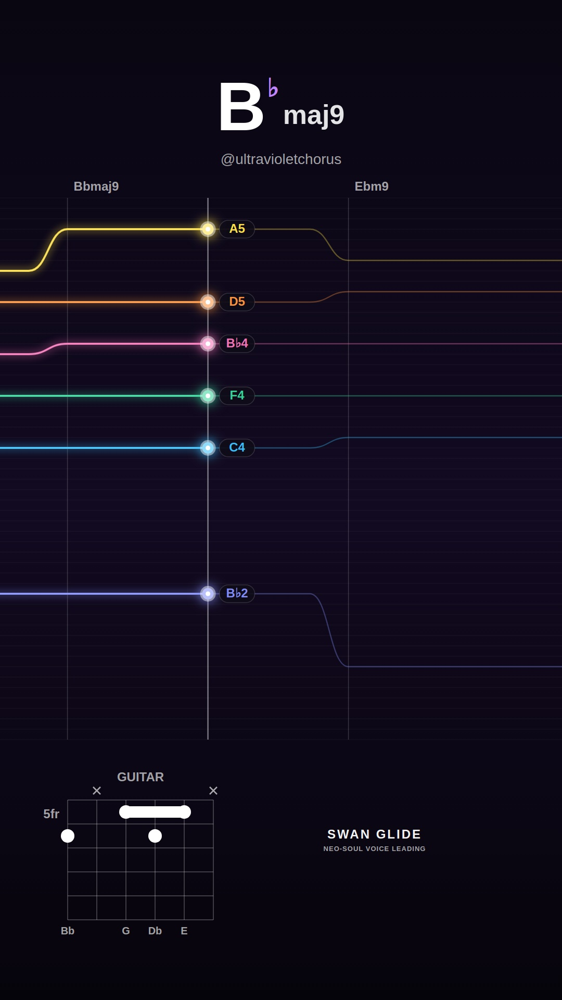
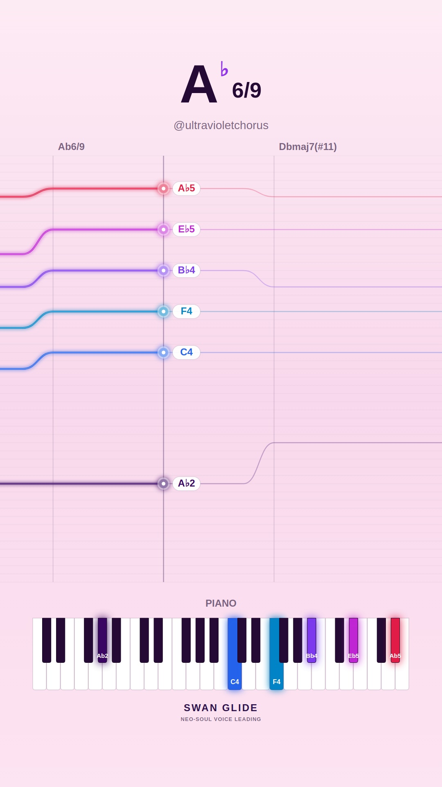
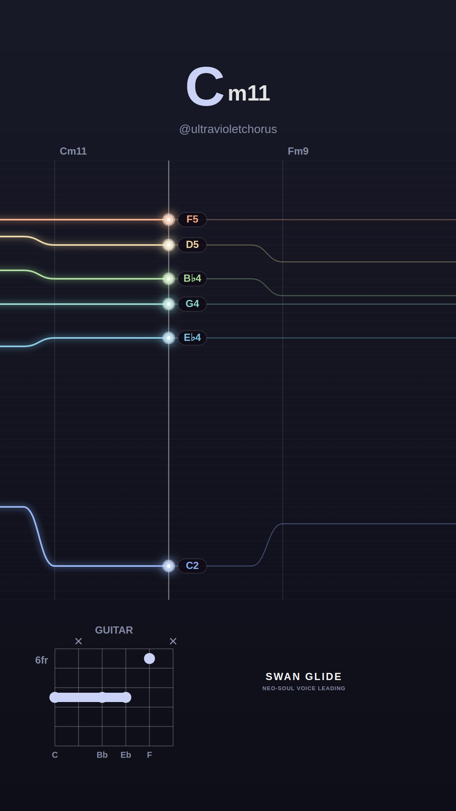
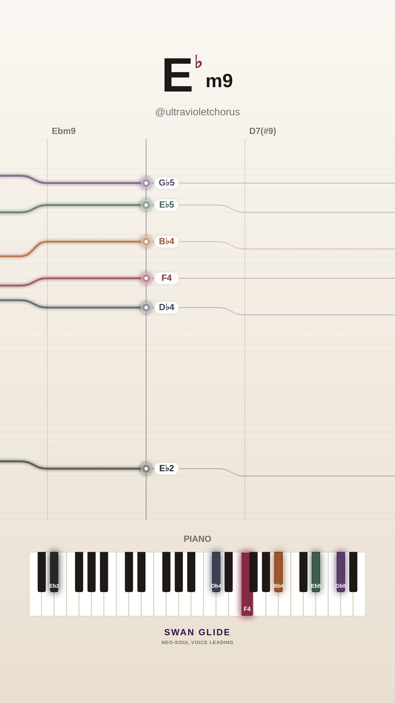
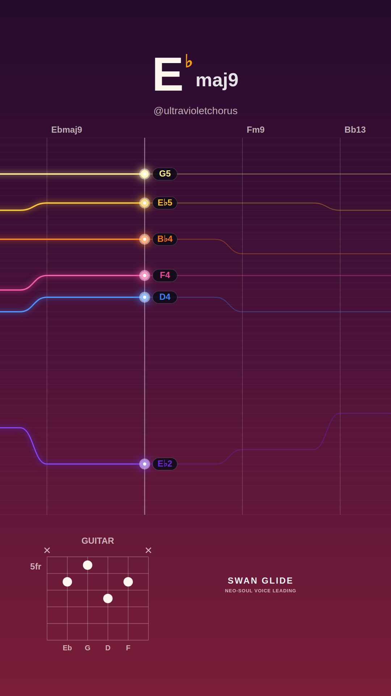
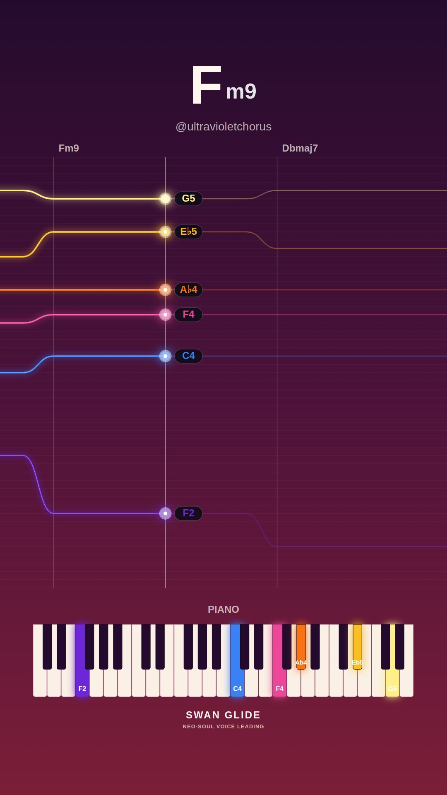
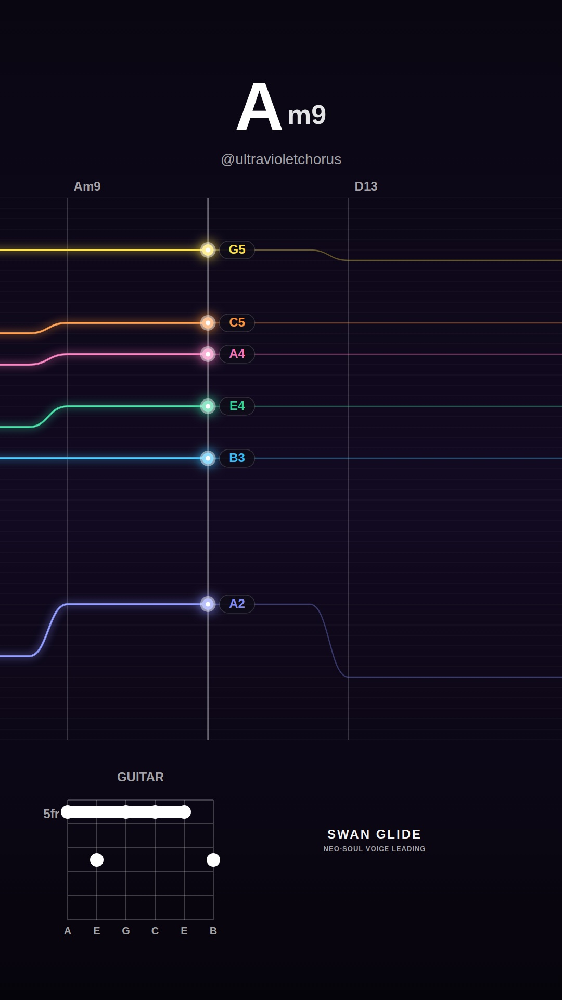
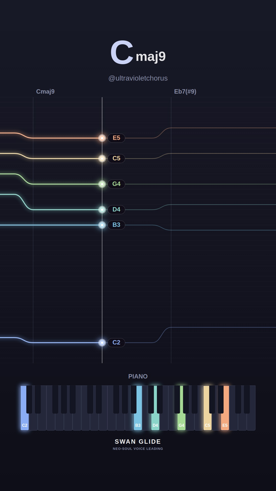
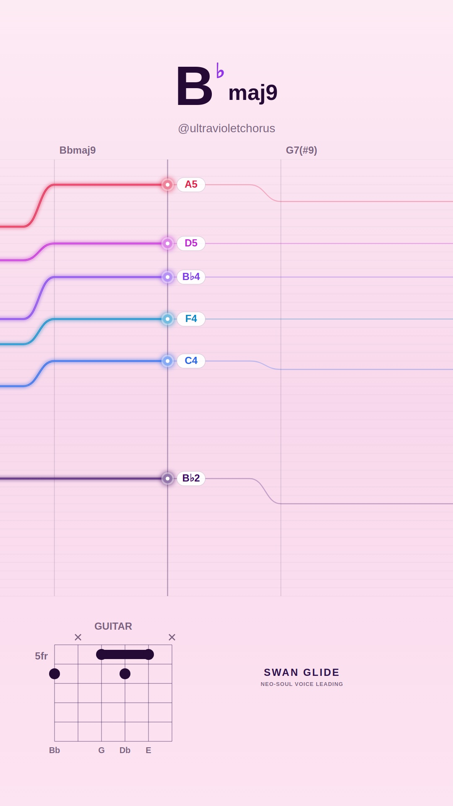
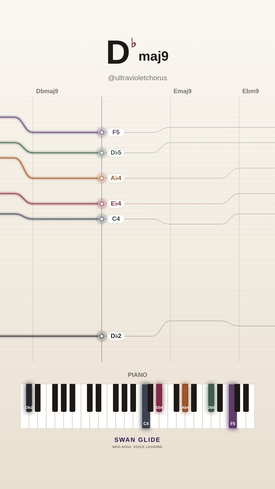

# 🕊️ Swan Glide Visualizers: 2026-11-05

Daily procedural neo-soul video collection featuring authentic voice-leading, harmonic analysis, and lush instrument diagrams.

Total Videos: **10**

| # | Video Preview | Track & Harmony | Instrument & Theme | Chord Progression |
| :---: | :--- | :--- | :--- | :--- |
| **1** |  [▶️ **Watch Video**](./song_1793897701_1_smooth-rnb/video.mp4) | **Warm Rhodes Breeze (in Bb)** • Mood: `smooth-rnb` • Key: **Bb** • Tempo: 70 BPM | 🎸 Guitar 🎨 Preset: `dark` | `Bbmaj9` → `Ebm9` → `Ab13` → `Bbmaj9` |
| **2** |  [▶️ **Watch Video**](./song_1793897729_2_dreamy-major/video.mp4) | **Celestial Drift (in Ab)** • Mood: `dreamy-major` • Key: **Ab** • Tempo: 68 BPM | 🎹 Piano 🎨 Preset: `pastel` | `Ab6/9` → `Dbmaj7(#11)` → `Gbmaj9` → `Abmaj9` |
| **3** |  [▶️ **Watch Video**](./song_1793897759_3_melancholy-minor/video.mp4) | **Paper Lanterns (in C)** • Mood: `melancholy-minor` • Key: **C** • Tempo: 64 BPM | 🎸 Guitar 🎨 Preset: `lofi` | `Cm11` → `Fm9` → `Bb13` → `Ebmaj9` → `Dm7b5` → `G7(b13)` |
| **4** |  [▶️ **Watch Video**](./song_1793897805_4_spicy-altered/video.mp4) | **Altered Smoke (in Db)** • Mood: `spicy-altered` • Key: **Db** • Tempo: 68 BPM | 🎹 Piano 🎨 Preset: `cream` | `Ebm9` → `D7(#9)` → `Dbmaj9` → `Bb7(b13)` → `E7(#9)` |
| **5** |  [▶️ **Watch Video**](./song_1793897833_5_dreamy-major/video.mp4) | **Lydian Shimmer (in Eb)** • Mood: `dreamy-major` • Key: **Eb** • Tempo: 67 BPM | 🎸 Guitar 🎨 Preset: `sunset` | `Ebmaj9` → `Fm9` → `Bb13` → `Gm7` → `Abmaj7(#11)` |
| **6** |  [▶️ **Watch Video**](./song_1793897861_6_melancholy-minor/video.mp4) | **Autumn Raindrops (in F)** • Mood: `melancholy-minor` • Key: **F** • Tempo: 66 BPM | 🎹 Piano 🎨 Preset: `sunset` | `Fm9` → `Dbmaj7` → `Gm7b5` → `C7(b13)` |
| **7** |  [▶️ **Watch Video**](./song_1793897890_7_smooth-rnb/video.mp4) | **Late Night Call (in G)** • Mood: `smooth-rnb` • Key: **G** • Tempo: 72 BPM | 🎸 Guitar 🎨 Preset: `dark` | `Am9` → `D13` → `Gmaj9` → `E7(#9)` |
| **8** |  [▶️ **Watch Video**](./song_1793897914_8_spicy-altered/video.mp4) | **Neon Midnight (in C)** • Mood: `spicy-altered` • Key: **C** • Tempo: 66 BPM | 🎹 Piano 🎨 Preset: `lofi` | `Cmaj9` → `Eb7(#9)` → `Dm9` → `Db7(b13)` |
| **9** |  [▶️ **Watch Video**](./song_1793897943_9_spicy-altered/video.mp4) | **Tritone Whispers (in Bb)** • Mood: `spicy-altered` • Key: **Bb** • Tempo: 65 BPM | 🎸 Guitar 🎨 Preset: `pastel` | `Bbmaj9` → `G7(#9)` → `Cm9` → `F7(alt)` → `B7(b13)` → `Bbmaj7(#11)` |
| **10** |  [▶️ **Watch Video**](./song_1793897981_10_smooth-rnb/video.mp4) | **Sunday Sunset (in Db)** • Mood: `smooth-rnb` • Key: **Db** • Tempo: 69 BPM | 🎹 Piano 🎨 Preset: `cream` | `Dbmaj9` → `Emaj9` → `Ebm9` → `Ab13` → `Gbm9` → `Dbmaj9` |

[← Back to Main Gallery](../README.md)
