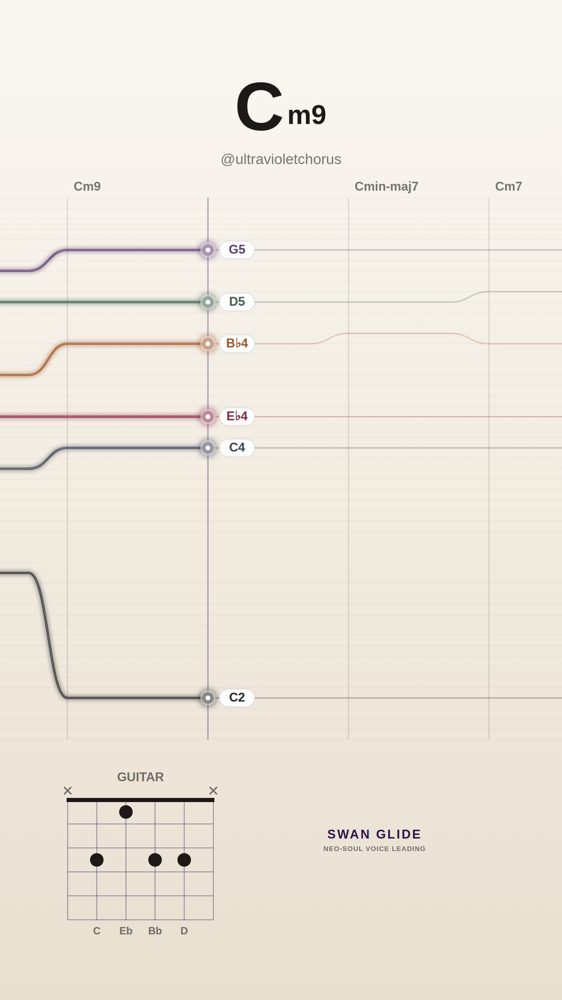
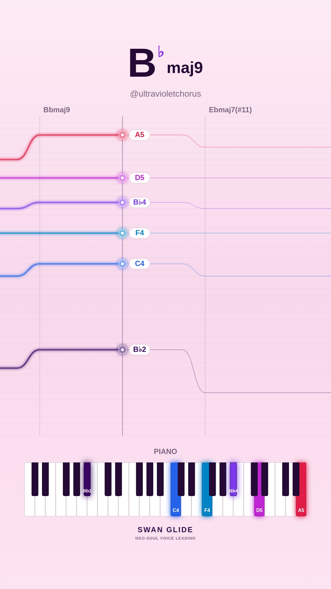
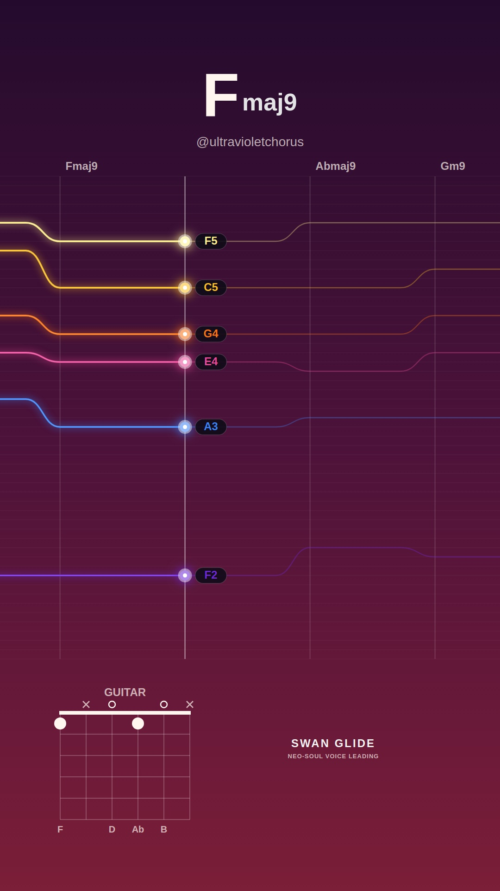
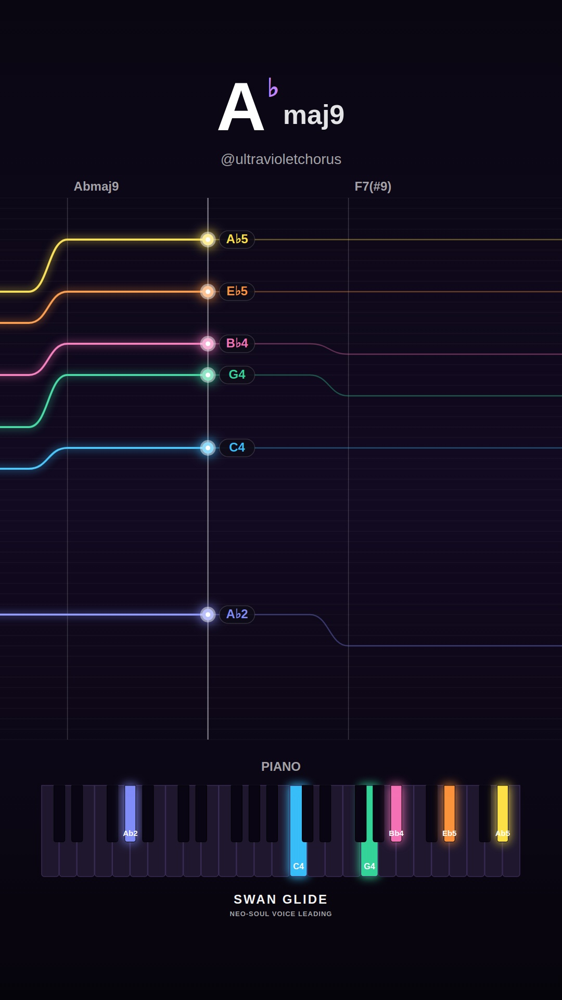
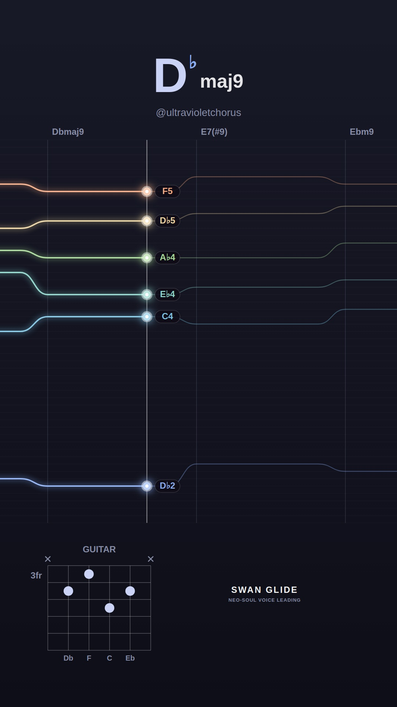
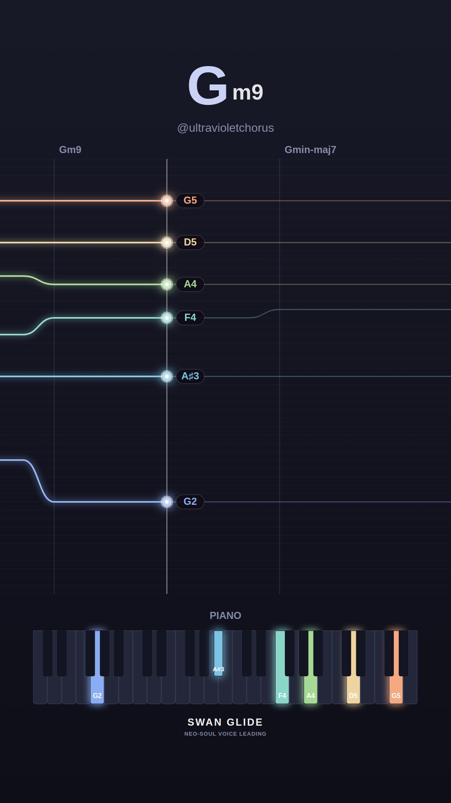
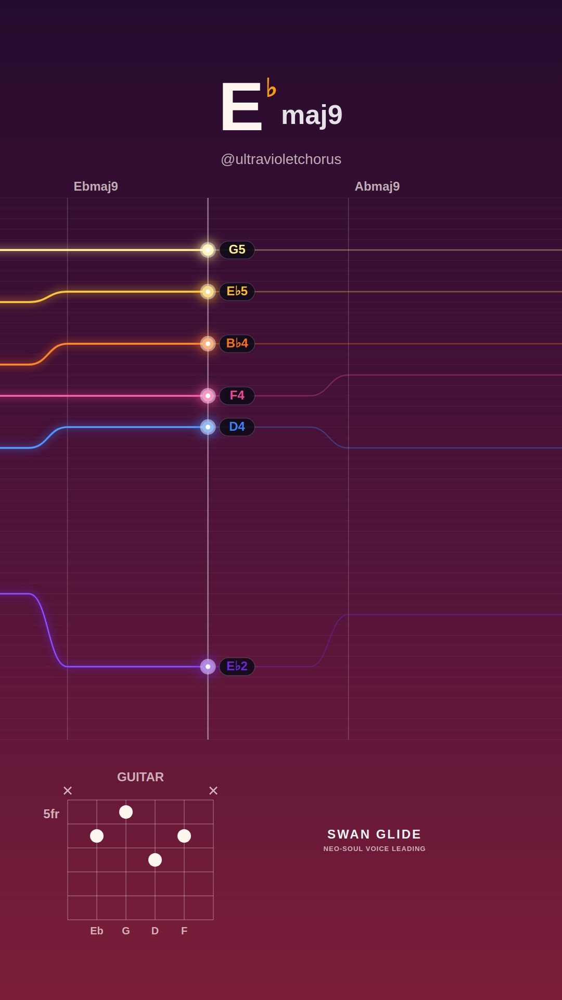
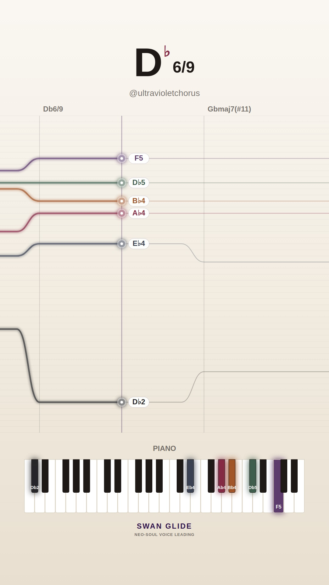
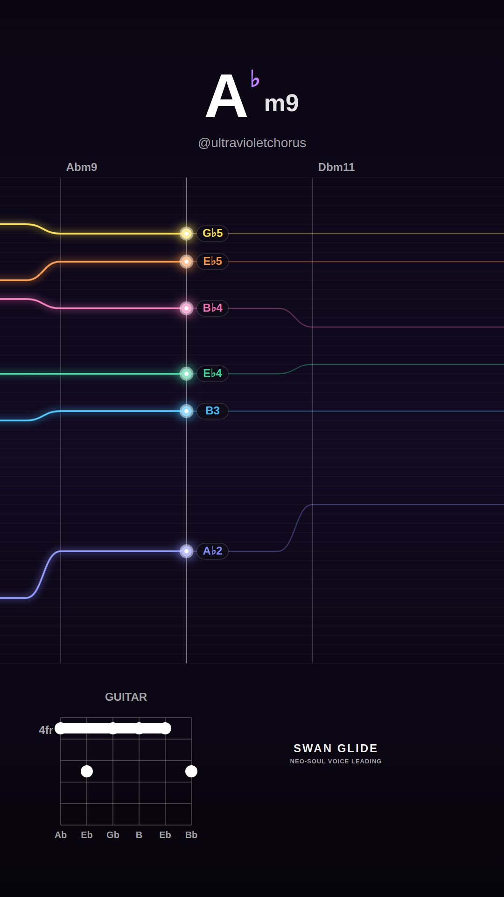
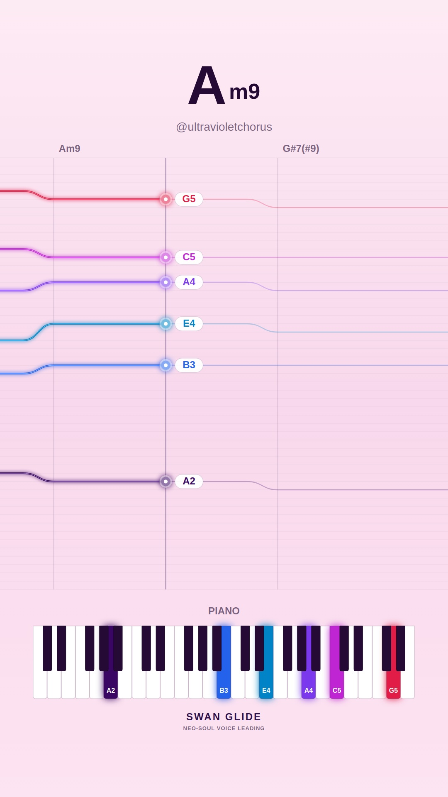

# 🕊️ Swan Glide Visualizers: 2026-11-07

Daily procedural neo-soul video collection featuring authentic voice-leading, harmonic analysis, and lush instrument diagrams.

Total Videos: **10**

| # | Video Preview | Track & Harmony | Instrument & Theme | Chord Progression |
| :---: | :--- | :--- | :--- | :--- |
| **1** |  [▶️ **Watch Video**](./song_1794064535_1_melancholy-minor/video.mp4) | **Autumn Raindrops (in C)** • Mood: `melancholy-minor` • Key: **C** • Tempo: 65 BPM | 🎸 Guitar 🎨 Preset: `cream` | `Cm9` → `Cmin-maj7` → `Cm7` → `Fm9` → `Dm7b5` → `G7(b13)` → `Cm11` |
| **2** |  [▶️ **Watch Video**](./song_1794064590_2_dreamy-major/video.mp4) | **Morning Silk (in Bb)** • Mood: `dreamy-major` • Key: **Bb** • Tempo: 65 BPM | 🎹 Piano 🎨 Preset: `pastel` | `Bbmaj9` → `Ebmaj7(#11)` → `Dm7` → `Gm9` |
| **3** |  [▶️ **Watch Video**](./song_1794064633_3_smooth-rnb/video.mp4) | **Warm Rhodes Breeze (in F)** • Mood: `smooth-rnb` • Key: **F** • Tempo: 69 BPM | 🎸 Guitar 🎨 Preset: `sunset` | `Fmaj9` → `Abmaj9` → `Gm9` → `C13` → `Bbm9` → `Fmaj9` |
| **4** |  [▶️ **Watch Video**](./song_1794064684_4_spicy-altered/video.mp4) | **After Hours Jazz (in Ab)** • Mood: `spicy-altered` • Key: **Ab** • Tempo: 65 BPM | 🎹 Piano 🎨 Preset: `dark` | `Abmaj9` → `F7(#9)` → `Bbm9` → `Eb7(alt)` → `A7(b13)` → `Abmaj7(#11)` |
| **5** |  [▶️ **Watch Video**](./song_1794064747_5_spicy-altered/video.mp4) | **Spicy Diminished (in Db)** • Mood: `spicy-altered` • Key: **Db** • Tempo: 70 BPM | 🎸 Guitar 🎨 Preset: `lofi` | `Dbmaj9` → `E7(#9)` → `Ebm9` → `Ab7(#9)` → `Fm9` → `Bb7(b13)` → `Ebm9` → `D7(b13)` |
| **6** |  [▶️ **Watch Video**](./song_1794064808_6_melancholy-minor/video.mp4) | **Autumn Raindrops (in G)** • Mood: `melancholy-minor` • Key: **G** • Tempo: 65 BPM | 🎹 Piano 🎨 Preset: `lofi` | `Gm9` → `Gmin-maj7` → `Gm7` → `Cm9` |
| **7** |  [▶️ **Watch Video**](./song_1794064850_7_smooth-rnb/video.mp4) | **Warm Rhodes Breeze (in Eb)** • Mood: `smooth-rnb` • Key: **Eb** • Tempo: 67 BPM | 🎸 Guitar 🎨 Preset: `sunset` | `Ebmaj9` → `Abmaj9` → `Gm7` → `Cm9` → `Fm9` → `Bb13` |
| **8** |  [▶️ **Watch Video**](./song_1794064912_8_dreamy-major/video.mp4) | **Celestial Drift (in Db)** • Mood: `dreamy-major` • Key: **Db** • Tempo: 68 BPM | 🎹 Piano 🎨 Preset: `cream` | `Db6/9` → `Gbmaj7(#11)` → `Bmaj9` → `Dbmaj9` |
| **9** |  [▶️ **Watch Video**](./song_1794064954_9_melancholy-minor/video.mp4) | **Midnight Reverie (in Ab)** • Mood: `melancholy-minor` • Key: **Ab** • Tempo: 67 BPM | 🎸 Guitar 🎨 Preset: `dark` | `Abm9` → `Dbm11` → `Emaj7(#11)` → `Bbm7b5` → `Eb7(b13)` |
| **10** |  [▶️ **Watch Video**](./song_1794065000_10_spicy-altered/video.mp4) | **After Hours Jazz (in G)** • Mood: `spicy-altered` • Key: **G** • Tempo: 68 BPM | 🎹 Piano 🎨 Preset: `pastel` | `Am9` → `G#7(#9)` → `Gmaj9` → `E7(b13)` → `A#7(#9)` |

[← Back to Main Gallery](../README.md)
