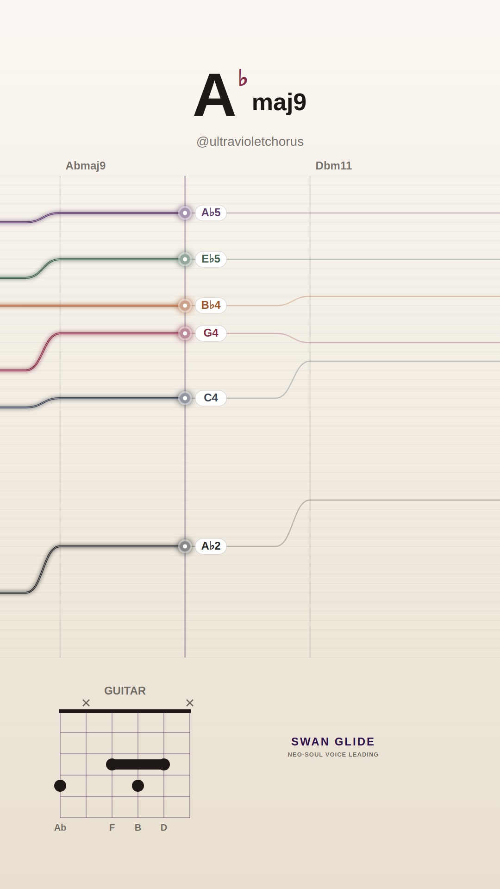
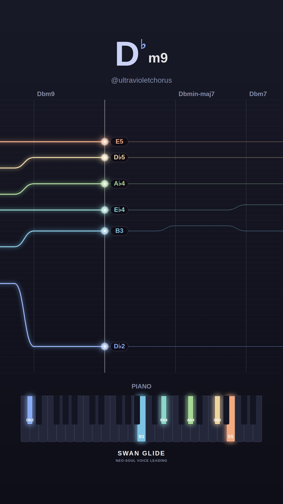
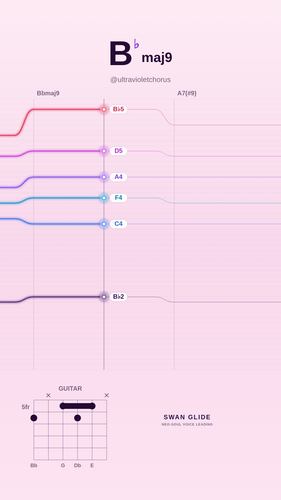
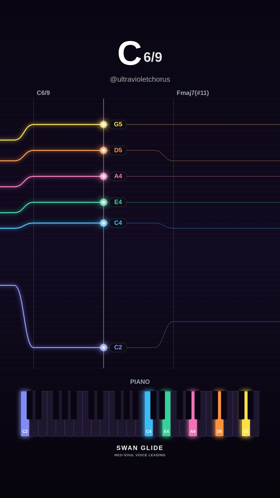
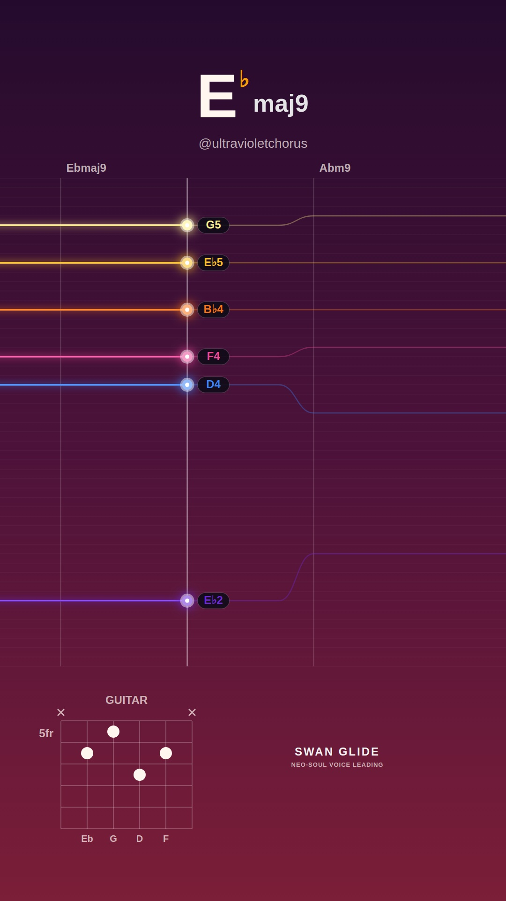
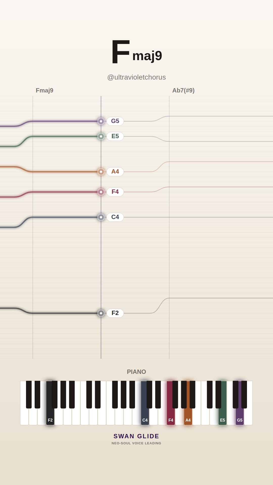
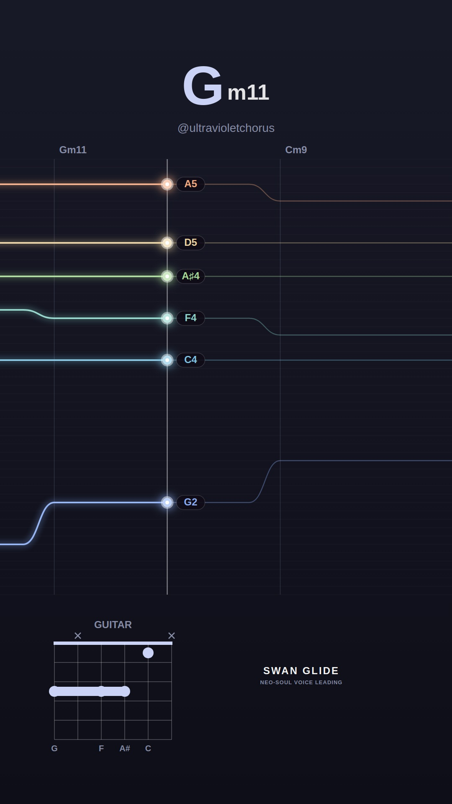
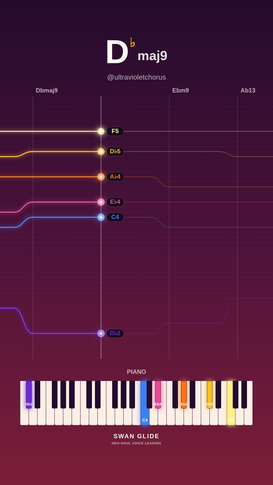
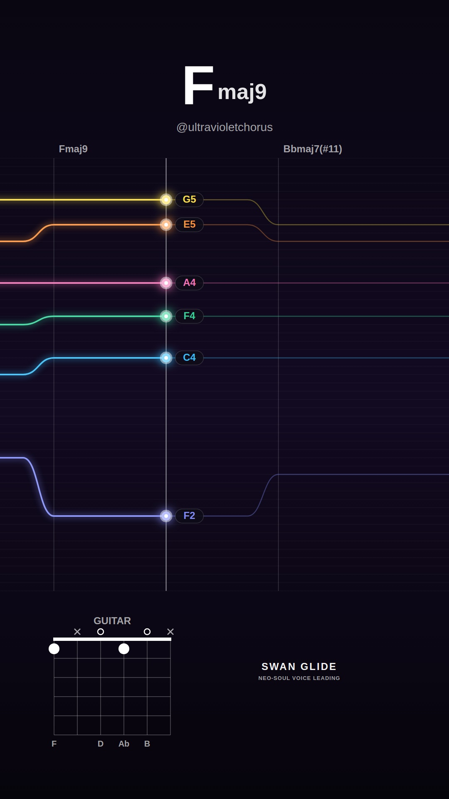
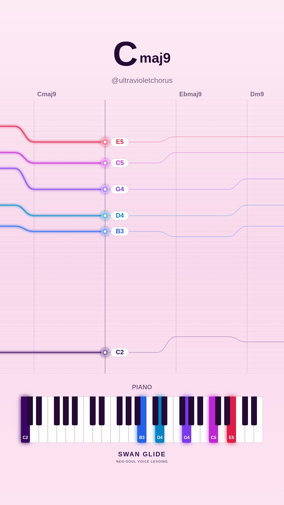

# 🕊️ Swan Glide Visualizers: 2026-11-10

Daily procedural neo-soul video collection featuring authentic voice-leading, harmonic analysis, and lush instrument diagrams.

Total Videos: **10**

| # | Video Preview | Track & Harmony | Instrument & Theme | Chord Progression |
| :---: | :--- | :--- | :--- | :--- |
| **1** |  [▶️ **Watch Video**](./song_1794328773_1_smooth-rnb/video.mp4) | **Silk & Honey (in Ab)** • Mood: `smooth-rnb` • Key: **Ab** • Tempo: 73 BPM | 🎸 Guitar 🎨 Preset: `cream` | `Abmaj9` → `Dbm11` → `Gb13` → `Bbm9` → `Eb7(b13)` |
| **2** |  [▶️ **Watch Video**](./song_1794328810_2_melancholy-minor/video.mp4) | **Distant Blue (in Db)** • Mood: `melancholy-minor` • Key: **Db** • Tempo: 65 BPM | 🎹 Piano 🎨 Preset: `lofi` | `Dbm9` → `Dbmin-maj7` → `Dbm7` → `Gbm9` → `Ebm7b5` → `Ab7(b13)` → `Dbm11` |
| **3** |  [▶️ **Watch Video**](./song_1794328857_3_spicy-altered/video.mp4) | **After Hours Jazz (in Bb)** • Mood: `spicy-altered` • Key: **Bb** • Tempo: 64 BPM | 🎸 Guitar 🎨 Preset: `pastel` | `Bbmaj9` → `A7(#9)` → `Dm9` → `Cm9` → `F13` → `Bbmaj7(#11)` → `A7(b13)` |
| **4** |  [▶️ **Watch Video**](./song_1794328912_4_dreamy-major/video.mp4) | **Lydian Shimmer (in C)** • Mood: `dreamy-major` • Key: **C** • Tempo: 68 BPM | 🎹 Piano 🎨 Preset: `dark` | `C6/9` → `Fmaj7(#11)` → `Bbmaj9` → `Cmaj9` |
| **5** |  [▶️ **Watch Video**](./song_1794328946_5_smooth-rnb/video.mp4) | **Sunday Sunset (in Eb)** • Mood: `smooth-rnb` • Key: **Eb** • Tempo: 70 BPM | 🎸 Guitar 🎨 Preset: `sunset` | `Ebmaj9` → `Abm9` → `Db13` → `Ebmaj9` |
| **6** |  [▶️ **Watch Video**](./song_1794328979_6_spicy-altered/video.mp4) | **Altered Smoke (in F)** • Mood: `spicy-altered` • Key: **F** • Tempo: 66 BPM | 🎹 Piano 🎨 Preset: `cream` | `Fmaj9` → `Ab7(#9)` → `Gm9` → `Gb7(b13)` |
| **7** |  [▶️ **Watch Video**](./song_1794329014_7_melancholy-minor/video.mp4) | **Autumn Raindrops (in G)** • Mood: `melancholy-minor` • Key: **G** • Tempo: 64 BPM | 🎸 Guitar 🎨 Preset: `lofi` | `Gm11` → `Cm9` → `F13` → `A#maj9` → `Am7b5` → `D7(b13)` |
| **8** |  [▶️ **Watch Video**](./song_1794329066_8_dreamy-major/video.mp4) | **Sunlit Waves (in Db)** • Mood: `dreamy-major` • Key: **Db** • Tempo: 67 BPM | 🎹 Piano 🎨 Preset: `sunset` | `Dbmaj9` → `Ebm9` → `Ab13` → `Fm7` → `Gbmaj7(#11)` |
| **9** |  [▶️ **Watch Video**](./song_1794329102_9_dreamy-major/video.mp4) | **Celestial Drift (in F)** • Mood: `dreamy-major` • Key: **F** • Tempo: 64 BPM | 🎸 Guitar 🎨 Preset: `dark` | `Fmaj9` → `Bbmaj7(#11)` → `Am9` → `Dm9` → `Gm9` → `C13` |
| **10** |  [▶️ **Watch Video**](./song_1794329155_10_smooth-rnb/video.mp4) | **Late Night Call (in C)** • Mood: `smooth-rnb` • Key: **C** • Tempo: 69 BPM | 🎹 Piano 🎨 Preset: `pastel` | `Cmaj9` → `Ebmaj9` → `Dm9` → `G13` → `Fm9` → `Cmaj9` |

[← Back to Main Gallery](../README.md)
