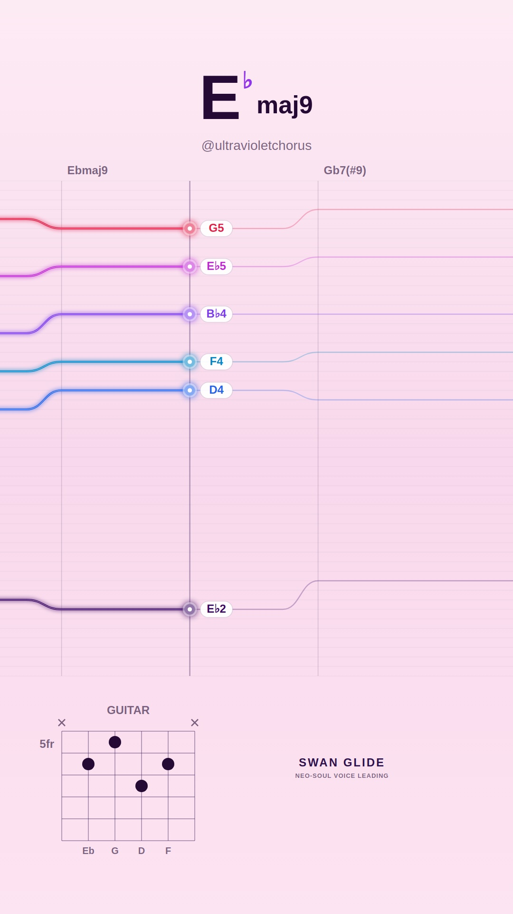
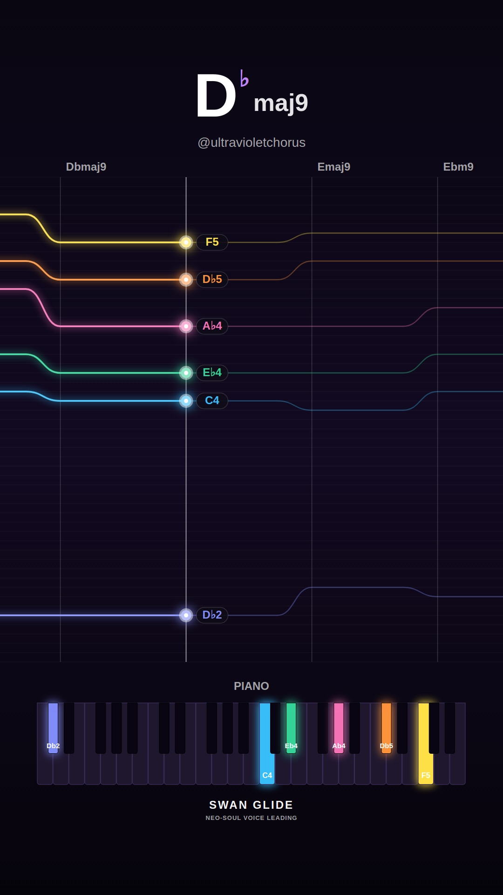
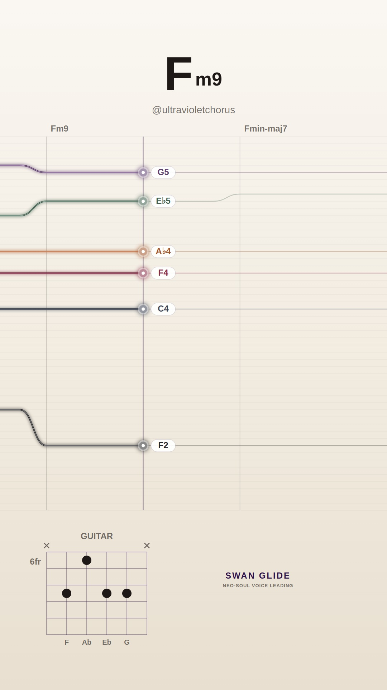
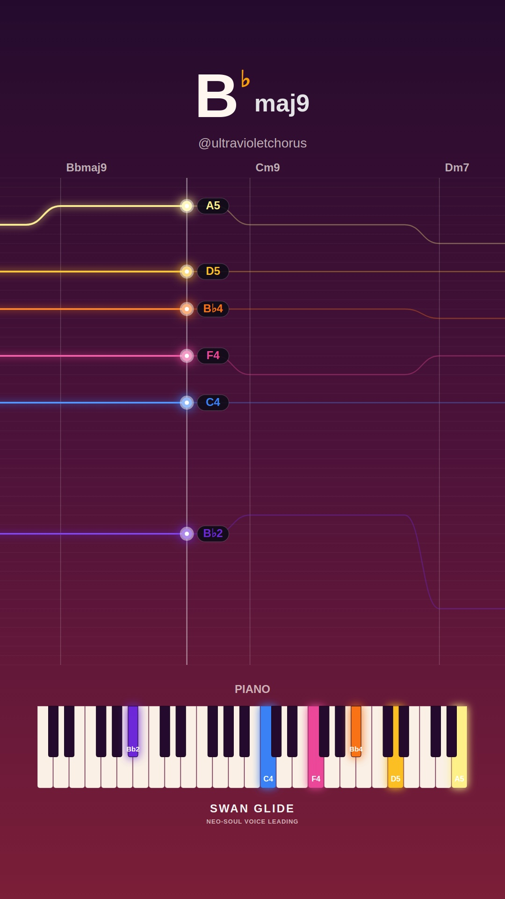
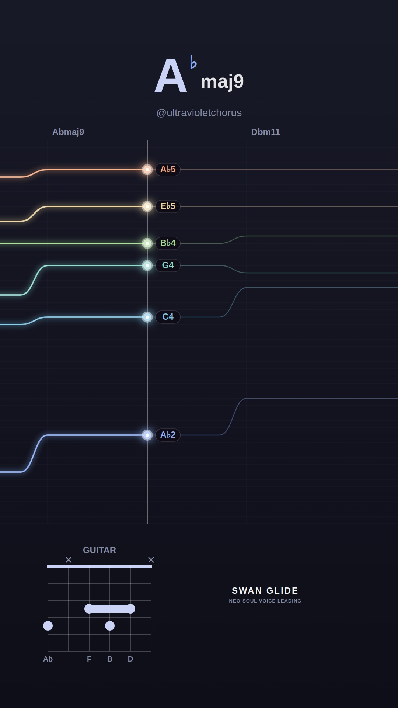
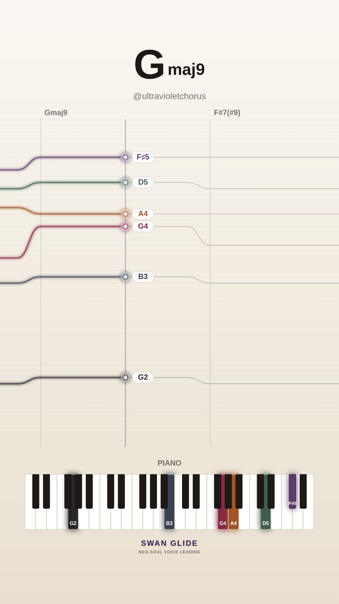
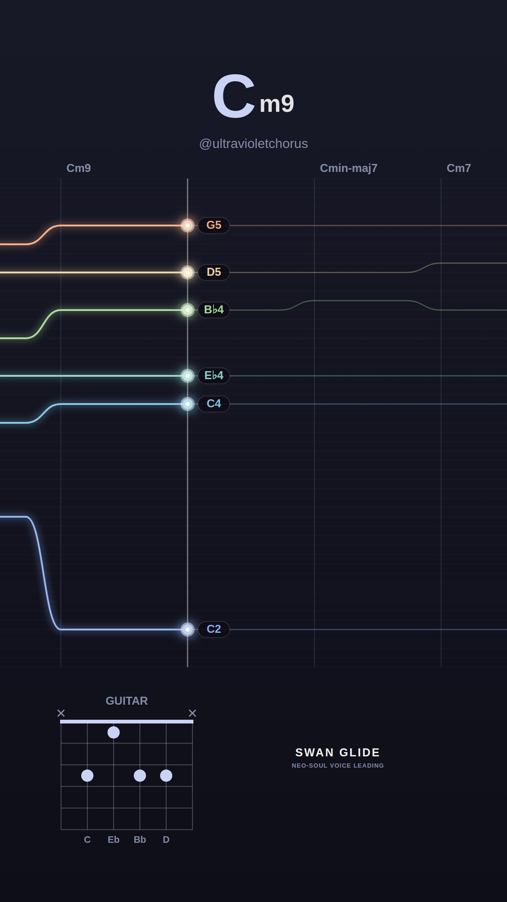
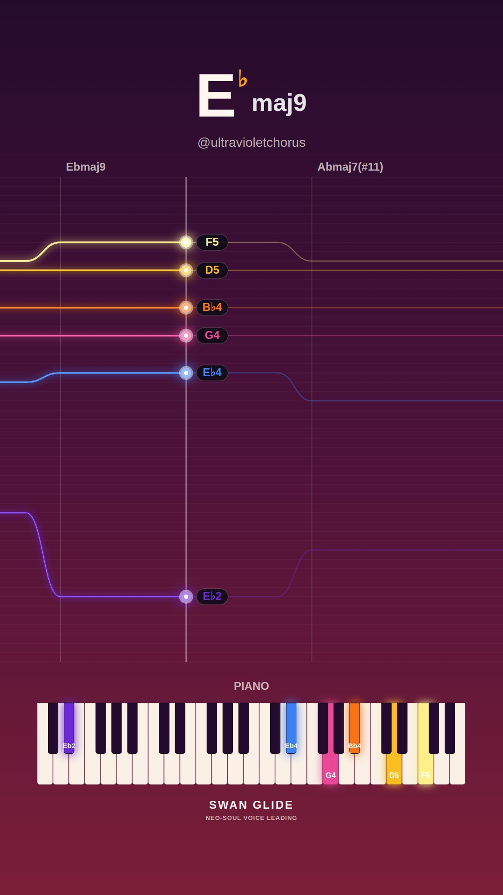
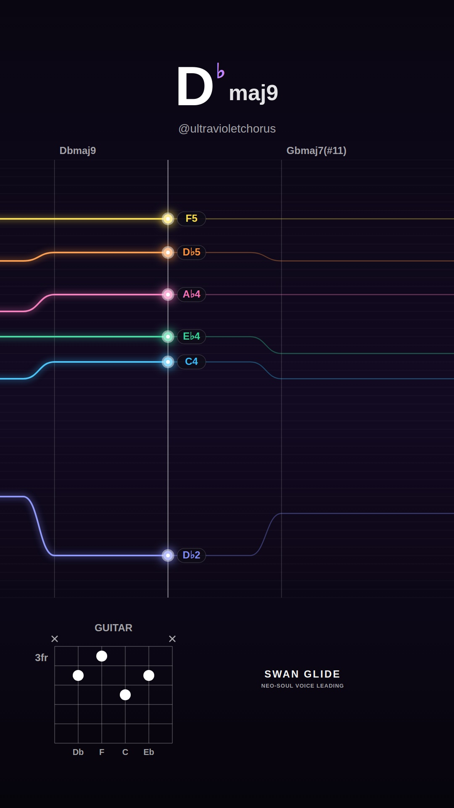
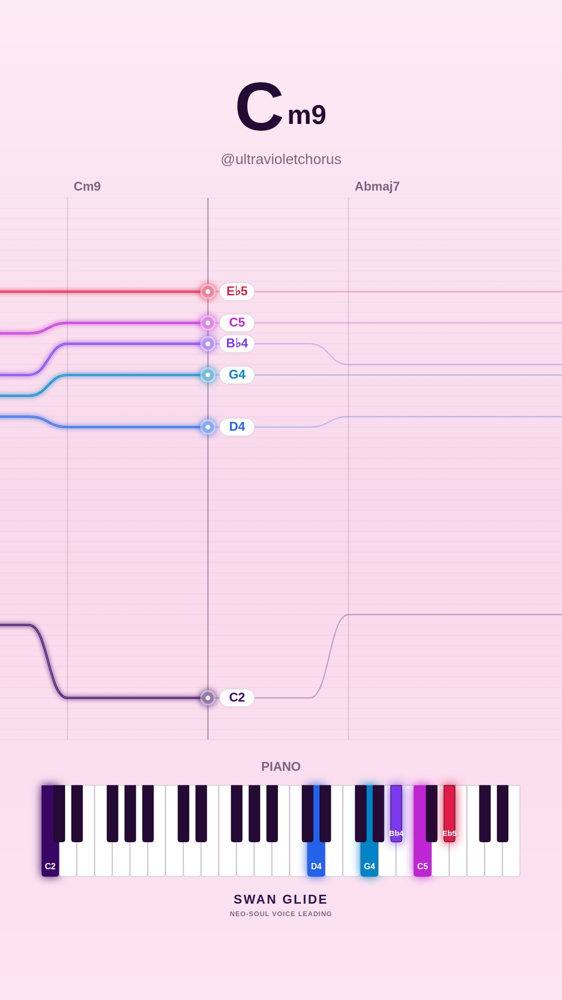

# 🕊️ Swan Glide Visualizers: 2026-11-17

Daily procedural neo-soul video collection featuring authentic voice-leading, harmonic analysis, and lush instrument diagrams.

Total Videos: **10**

| # | Video Preview | Track & Harmony | Instrument & Theme | Chord Progression |
| :---: | :--- | :--- | :--- | :--- |
| **1** |  [▶️ **Watch Video**](./song_1794938270_1_spicy-altered/video.mp4) | **Chromatic Glide (in Eb)** • Mood: `spicy-altered` • Key: **Eb** • Tempo: 66 BPM | 🎸 Guitar 🎨 Preset: `pastel` | `Ebmaj9` → `Gb7(#9)` → `Fm9` → `E7(b13)` |
| **2** |  [▶️ **Watch Video**](./song_1794938298_2_smooth-rnb/video.mp4) | **Warm Rhodes Breeze (in Db)** • Mood: `smooth-rnb` • Key: **Db** • Tempo: 69 BPM | 🎹 Piano 🎨 Preset: `dark` | `Dbmaj9` → `Emaj9` → `Ebm9` → `Ab13` → `Gbm9` → `Dbmaj9` |
| **3** |  [▶️ **Watch Video**](./song_1794938334_3_melancholy-minor/video.mp4) | **Distant Blue (in F)** • Mood: `melancholy-minor` • Key: **F** • Tempo: 65 BPM | 🎸 Guitar 🎨 Preset: `cream` | `Fm9` → `Fmin-maj7` → `Fm7` → `Bbm9` |
| **4** |  [▶️ **Watch Video**](./song_1794938361_4_dreamy-major/video.mp4) | **Velvet Horizon (in Bb)** • Mood: `dreamy-major` • Key: **Bb** • Tempo: 65 BPM | 🎹 Piano 🎨 Preset: `sunset` | `Bbmaj9` → `Cm9` → `Dm7` → `Ebmaj7(#11)` → `Gm9` → `F13` → `Ebmaj9` → `Bb6/9` |
| **5** |  [▶️ **Watch Video**](./song_1794938406_5_smooth-rnb/video.mp4) | **Late Night Call (in Ab)** • Mood: `smooth-rnb` • Key: **Ab** • Tempo: 73 BPM | 🎸 Guitar 🎨 Preset: `lofi` | `Abmaj9` → `Dbm11` → `Gb13` → `Bbm9` → `Eb7(b13)` |
| **6** |  [▶️ **Watch Video**](./song_1794938434_6_spicy-altered/video.mp4) | **Neon Midnight (in G)** • Mood: `spicy-altered` • Key: **G** • Tempo: 64 BPM | 🎹 Piano 🎨 Preset: `cream` | `Gmaj9` → `F#7(#9)` → `Bm9` → `Am9` → `D13` → `Gmaj7(#11)` → `F#7(b13)` |
| **7** |  [▶️ **Watch Video**](./song_1794938478_7_melancholy-minor/video.mp4) | **Distant Blue (in C)** • Mood: `melancholy-minor` • Key: **C** • Tempo: 65 BPM | 🎸 Guitar 🎨 Preset: `lofi` | `Cm9` → `Cmin-maj7` → `Cm7` → `Fm9` → `Dm7b5` → `G7(b13)` → `Cm11` |
| **8** |  [▶️ **Watch Video**](./song_1794938512_8_dreamy-major/video.mp4) | **Golden Hour Glow (in Eb)** • Mood: `dreamy-major` • Key: **Eb** • Tempo: 65 BPM | 🎹 Piano 🎨 Preset: `sunset` | `Ebmaj9` → `Abmaj7(#11)` → `Gm7` → `Cm9` |
| **9** |  [▶️ **Watch Video**](./song_1794938541_9_dreamy-major/video.mp4) | **Celestial Drift (in Db)** • Mood: `dreamy-major` • Key: **Db** • Tempo: 64 BPM | 🎸 Guitar 🎨 Preset: `dark` | `Dbmaj9` → `Gbmaj7(#11)` → `Fm9` → `Bbm9` → `Ebm9` → `Ab13` |
| **10** |  [▶️ **Watch Video**](./song_1794938584_10_melancholy-minor/video.mp4) | **Quiet Solitude (in C)** • Mood: `melancholy-minor` • Key: **C** • Tempo: 66 BPM | 🎹 Piano 🎨 Preset: `pastel` | `Cm9` → `Abmaj7` → `Dm7b5` → `G7(b13)` |

[← Back to Main Gallery](../README.md)
