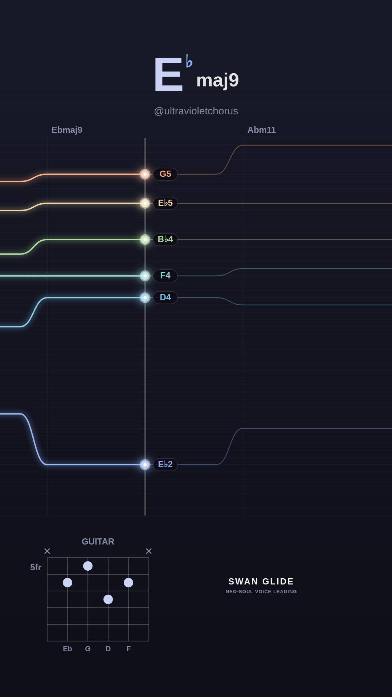
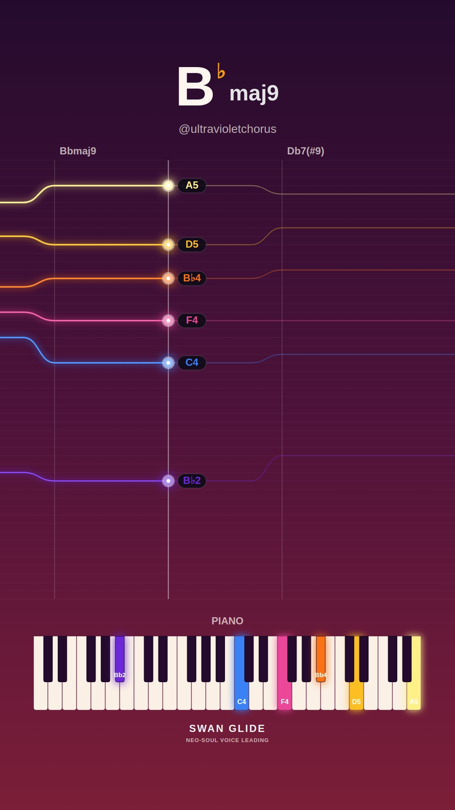
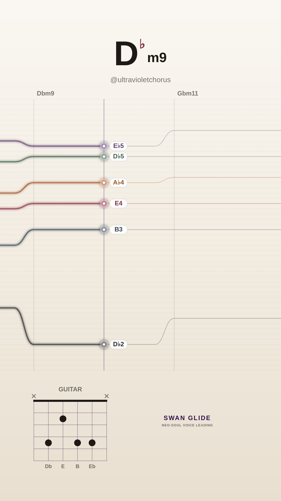
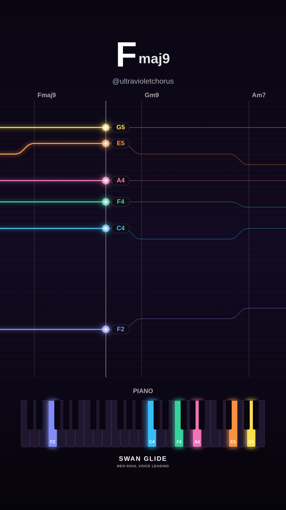
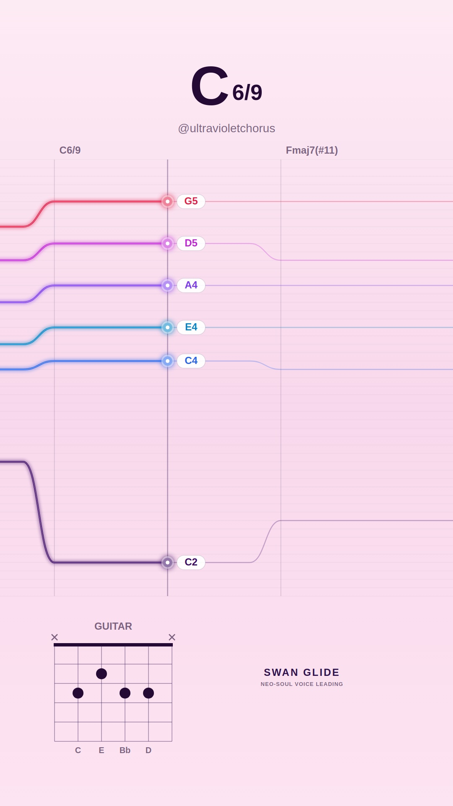
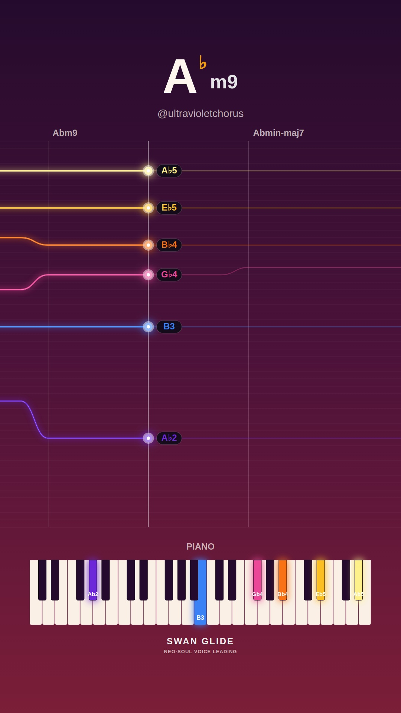
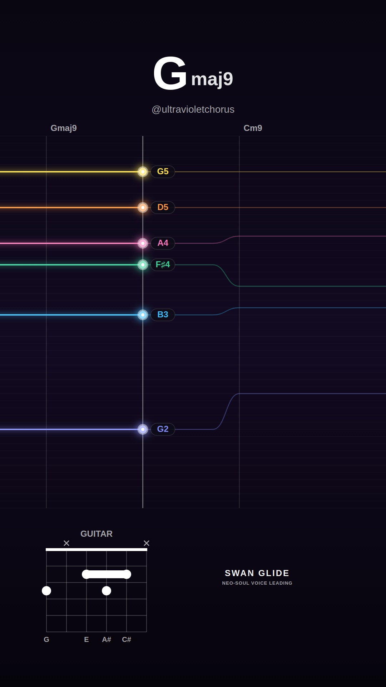
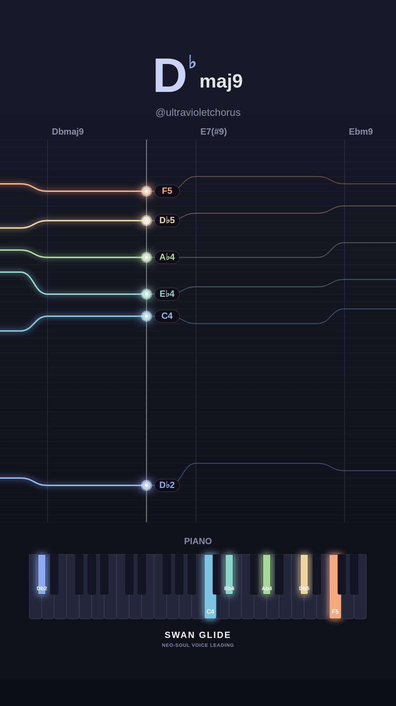
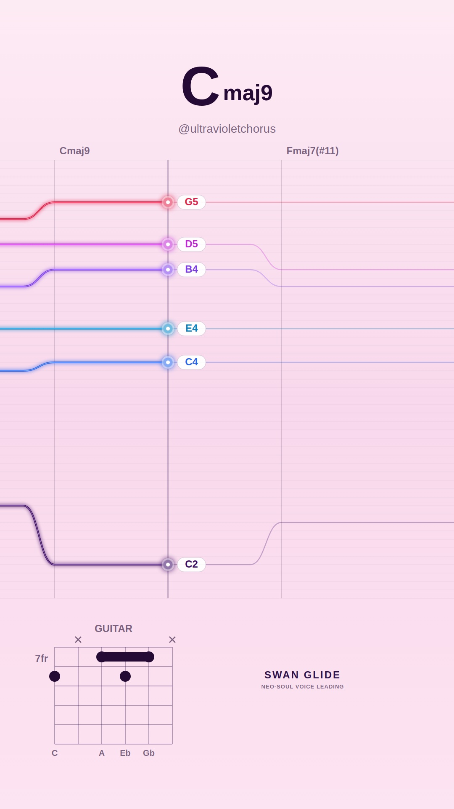
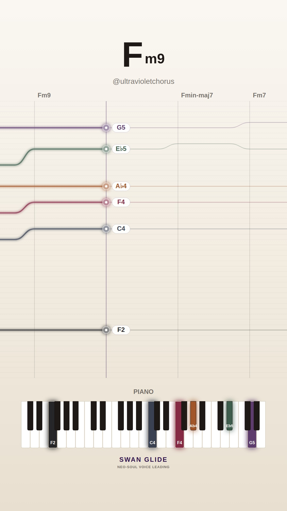

# 🕊️ Swan Glide Visualizers: 2026-11-19

Daily procedural neo-soul video collection featuring authentic voice-leading, harmonic analysis, and lush instrument diagrams.

Total Videos: **10**

| # | Video Preview | Track & Harmony | Instrument & Theme | Chord Progression |
| :---: | :--- | :--- | :--- | :--- |
| **1** |  [▶️ **Watch Video**](./song_1795110492_1_smooth-rnb/video.mp4) | **Warm Rhodes Breeze (in Eb)** • Mood: `smooth-rnb` • Key: **Eb** • Tempo: 73 BPM | 🎸 Guitar 🎨 Preset: `lofi` | `Ebmaj9` → `Abm11` → `Db13` → `Fm9` → `Bb7(b13)` |
| **2** |  [▶️ **Watch Video**](./song_1795110538_2_spicy-altered/video.mp4) | **Chromatic Glide (in Bb)** • Mood: `spicy-altered` • Key: **Bb** • Tempo: 66 BPM | 🎹 Piano 🎨 Preset: `sunset` | `Bbmaj9` → `Db7(#9)` → `Cm9` → `B7(b13)` |
| **3** |  [▶️ **Watch Video**](./song_1795110582_3_melancholy-minor/video.mp4) | **Midnight Reverie (in Db)** • Mood: `melancholy-minor` • Key: **Db** • Tempo: 67 BPM | 🎸 Guitar 🎨 Preset: `cream` | `Dbm9` → `Gbm11` → `Amaj7(#11)` → `Ebm7b5` → `Ab7(b13)` |
| **4** |  [▶️ **Watch Video**](./song_1795110629_4_dreamy-major/video.mp4) | **Morning Silk (in F)** • Mood: `dreamy-major` • Key: **F** • Tempo: 65 BPM | 🎹 Piano 🎨 Preset: `dark` | `Fmaj9` → `Gm9` → `Am7` → `Bbmaj7(#11)` → `Dm9` → `C13` → `Bbmaj9` → `F6/9` |
| **5** |  [▶️ **Watch Video**](./song_1795110699_5_dreamy-major/video.mp4) | **Morning Silk (in C)** • Mood: `dreamy-major` • Key: **C** • Tempo: 68 BPM | 🎸 Guitar 🎨 Preset: `pastel` | `C6/9` → `Fmaj7(#11)` → `Bbmaj9` → `Cmaj9` |
| **6** |  [▶️ **Watch Video**](./song_1795110739_6_melancholy-minor/video.mp4) | **Autumn Raindrops (in Ab)** • Mood: `melancholy-minor` • Key: **Ab** • Tempo: 65 BPM | 🎹 Piano 🎨 Preset: `sunset` | `Abm9` → `Abmin-maj7` → `Abm7` → `Dbm9` |
| **7** |  [▶️ **Watch Video**](./song_1795110784_7_smooth-rnb/video.mp4) | **Warm Rhodes Breeze (in G)** • Mood: `smooth-rnb` • Key: **G** • Tempo: 70 BPM | 🎸 Guitar 🎨 Preset: `dark` | `Gmaj9` → `Cm9` → `F13` → `Gmaj9` |
| **8** |  [▶️ **Watch Video**](./song_1795110822_8_spicy-altered/video.mp4) | **Chromatic Glide (in Db)** • Mood: `spicy-altered` • Key: **Db** • Tempo: 70 BPM | 🎹 Piano 🎨 Preset: `lofi` | `Dbmaj9` → `E7(#9)` → `Ebm9` → `Ab7(#9)` → `Fm9` → `Bb7(b13)` → `Ebm9` → `D7(b13)` |
| **9** |  [▶️ **Watch Video**](./song_1795110887_9_dreamy-major/video.mp4) | **Lydian Shimmer (in C)** • Mood: `dreamy-major` • Key: **C** • Tempo: 64 BPM | 🎸 Guitar 🎨 Preset: `pastel` | `Cmaj9` → `Fmaj7(#11)` → `Em9` → `Am9` → `Dm9` → `G13` |
| **10** |  [▶️ **Watch Video**](./song_1795110952_10_melancholy-minor/video.mp4) | **Autumn Raindrops (in F)** • Mood: `melancholy-minor` • Key: **F** • Tempo: 65 BPM | 🎹 Piano 🎨 Preset: `cream` | `Fm9` → `Fmin-maj7` → `Fm7` → `Bbm9` → `Gm7b5` → `C7(b13)` → `Fm11` |

[← Back to Main Gallery](../README.md)
