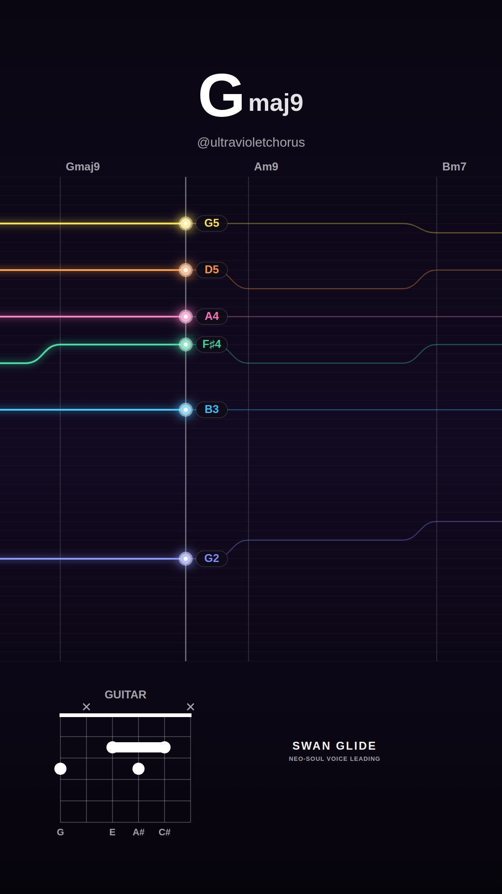
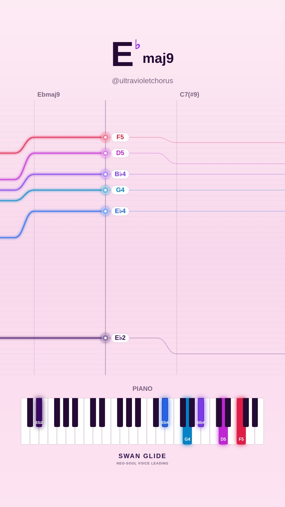
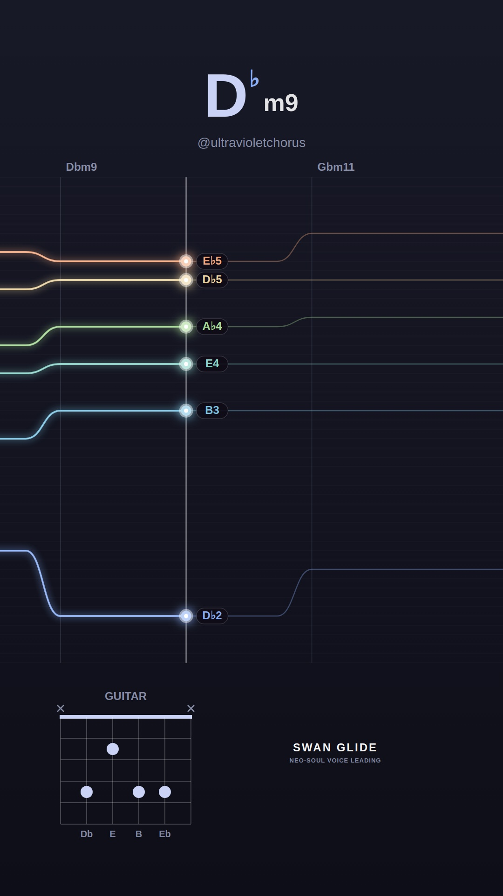
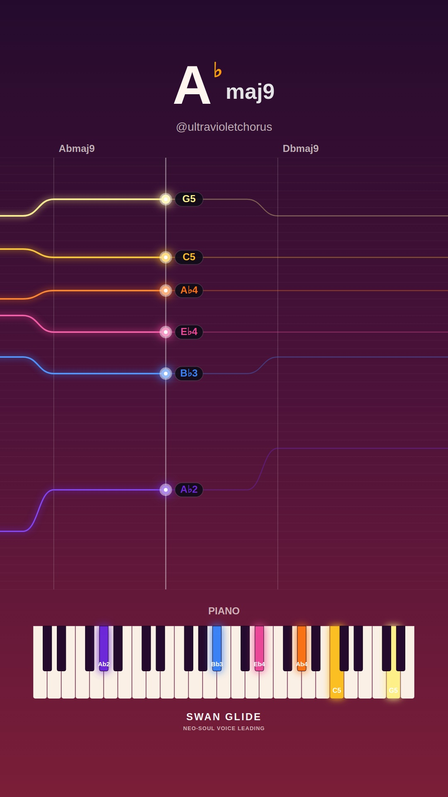
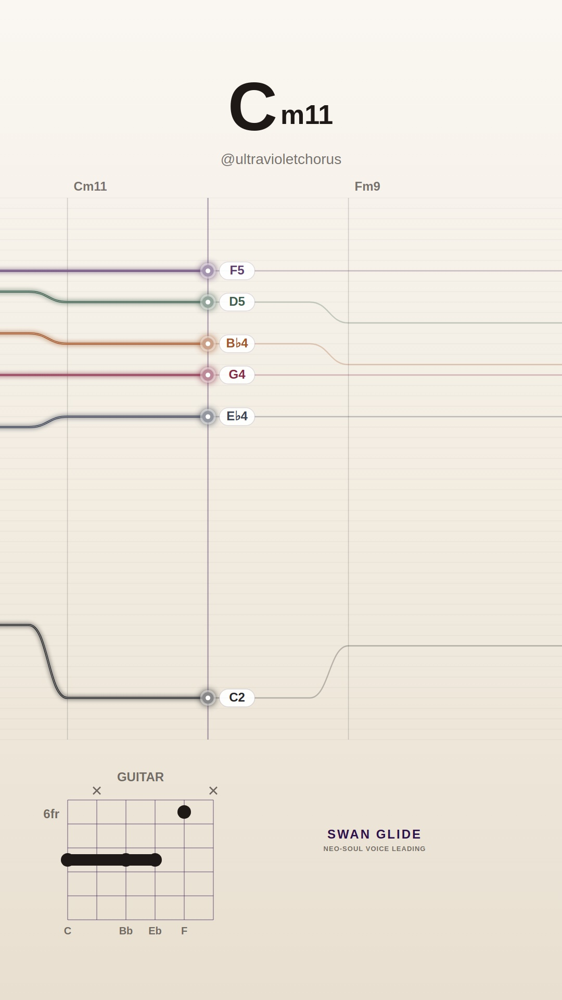
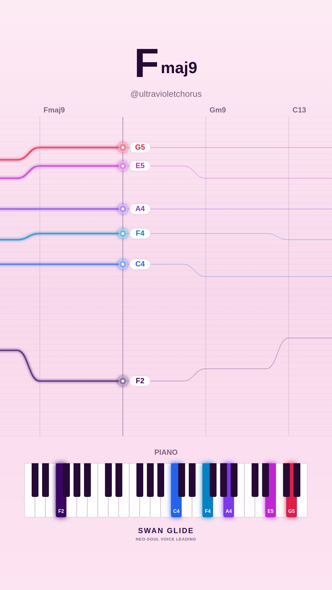
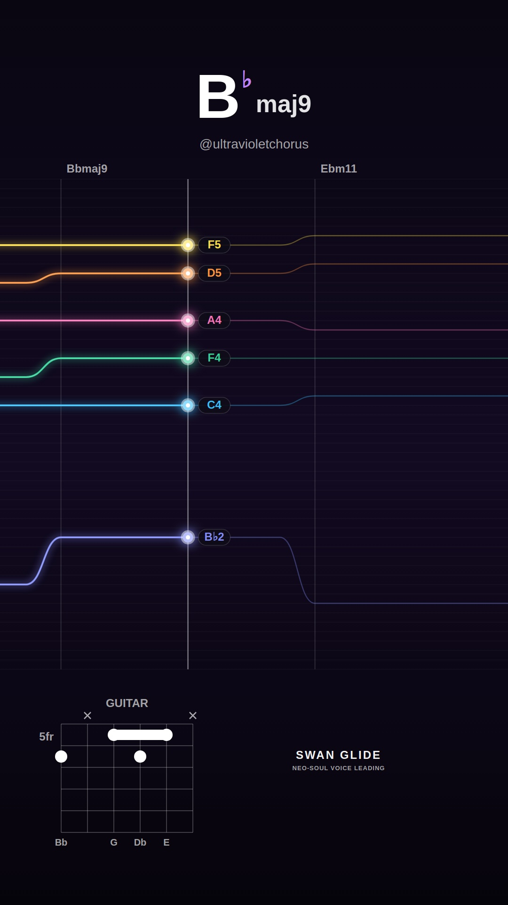
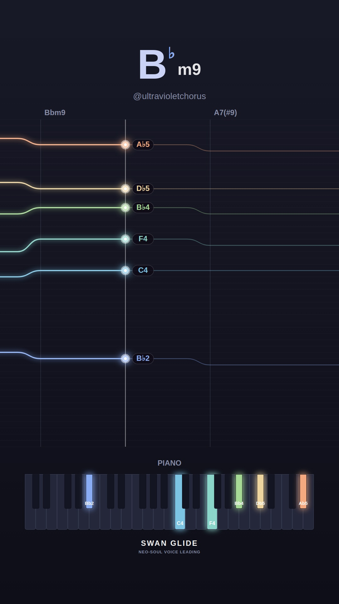
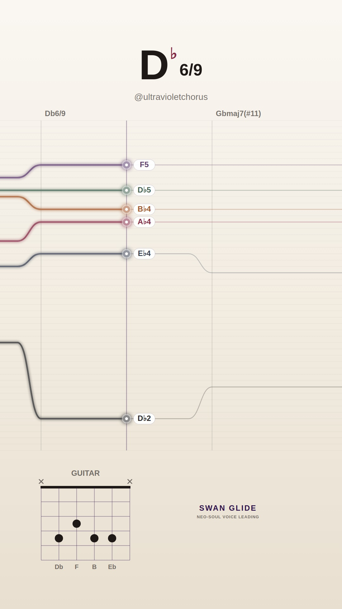
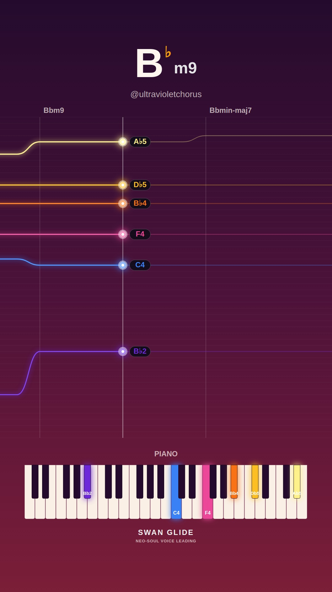

# 🕊️ Swan Glide Visualizers: 2026-11-21

Daily procedural neo-soul video collection featuring authentic voice-leading, harmonic analysis, and lush instrument diagrams.

Total Videos: **10**

| # | Video Preview | Track & Harmony | Instrument & Theme | Chord Progression |
| :---: | :--- | :--- | :--- | :--- |
| **1** |  [▶️ **Watch Video**](./song_1795278511_1_dreamy-major/video.mp4) | **Velvet Horizon (in G)** • Mood: `dreamy-major` • Key: **G** • Tempo: 65 BPM | 🎸 Guitar 🎨 Preset: `dark` | `Gmaj9` → `Am9` → `Bm7` → `Cmaj7(#11)` → `Em9` → `D13` → `Cmaj9` → `G6/9` |
| **2** |  [▶️ **Watch Video**](./song_1795278567_2_spicy-altered/video.mp4) | **Neon Midnight (in Eb)** • Mood: `spicy-altered` • Key: **Eb** • Tempo: 65 BPM | 🎹 Piano 🎨 Preset: `pastel` | `Ebmaj9` → `C7(#9)` → `Fm9` → `Bb7(alt)` → `E7(b13)` → `Ebmaj7(#11)` |
| **3** |  [▶️ **Watch Video**](./song_1795278620_3_melancholy-minor/video.mp4) | **Midnight Reverie (in Db)** • Mood: `melancholy-minor` • Key: **Db** • Tempo: 67 BPM | 🎸 Guitar 🎨 Preset: `lofi` | `Dbm9` → `Gbm11` → `Amaj7(#11)` → `Ebm7b5` → `Ab7(b13)` |
| **4** |  [▶️ **Watch Video**](./song_1795278659_4_smooth-rnb/video.mp4) | **Late Night Call (in Ab)** • Mood: `smooth-rnb` • Key: **Ab** • Tempo: 67 BPM | 🎹 Piano 🎨 Preset: `sunset` | `Abmaj9` → `Dbmaj9` → `Cm7` → `Fm9` → `Bbm9` → `Eb13` |
| **5** |  [▶️ **Watch Video**](./song_1795278714_5_melancholy-minor/video.mp4) | **Paper Lanterns (in C)** • Mood: `melancholy-minor` • Key: **C** • Tempo: 64 BPM | 🎸 Guitar 🎨 Preset: `cream` | `Cm11` → `Fm9` → `Bb13` → `Ebmaj9` → `Dm7b5` → `G7(b13)` |
| **6** |  [▶️ **Watch Video**](./song_1795278768_6_dreamy-major/video.mp4) | **Velvet Horizon (in F)** • Mood: `dreamy-major` • Key: **F** • Tempo: 67 BPM | 🎹 Piano 🎨 Preset: `pastel` | `Fmaj9` → `Gm9` → `C13` → `Am7` → `Bbmaj7(#11)` |
| **7** |  [▶️ **Watch Video**](./song_1795278803_7_smooth-rnb/video.mp4) | **Smooth Glide (in Bb)** • Mood: `smooth-rnb` • Key: **Bb** • Tempo: 73 BPM | 🎸 Guitar 🎨 Preset: `dark` | `Bbmaj9` → `Ebm11` → `Ab13` → `Cm9` → `F7(b13)` |
| **8** |  [▶️ **Watch Video**](./song_1795278838_8_spicy-altered/video.mp4) | **Altered Smoke (in Ab)** • Mood: `spicy-altered` • Key: **Ab** • Tempo: 68 BPM | 🎹 Piano 🎨 Preset: `lofi` | `Bbm9` → `A7(#9)` → `Abmaj9` → `F7(b13)` → `B7(#9)` |
| **9** |  [▶️ **Watch Video**](./song_1795278872_9_dreamy-major/video.mp4) | **Sunlit Waves (in Db)** • Mood: `dreamy-major` • Key: **Db** • Tempo: 68 BPM | 🎸 Guitar 🎨 Preset: `cream` | `Db6/9` → `Gbmaj7(#11)` → `Bmaj9` → `Dbmaj9` |
| **10** |  [▶️ **Watch Video**](./song_1795278905_10_melancholy-minor/video.mp4) | **Midnight Reverie (in Bb)** • Mood: `melancholy-minor` • Key: **Bb** • Tempo: 65 BPM | 🎹 Piano 🎨 Preset: `sunset` | `Bbm9` → `Bbmin-maj7` → `Bbm7` → `Ebm9` |

[← Back to Main Gallery](../README.md)
