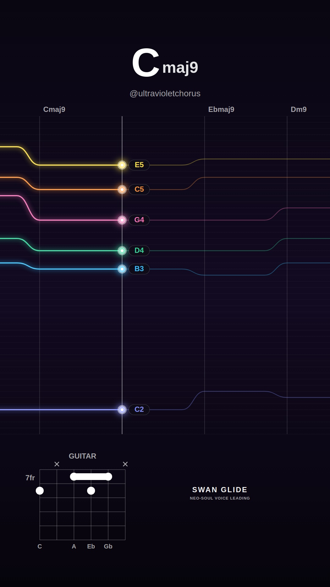
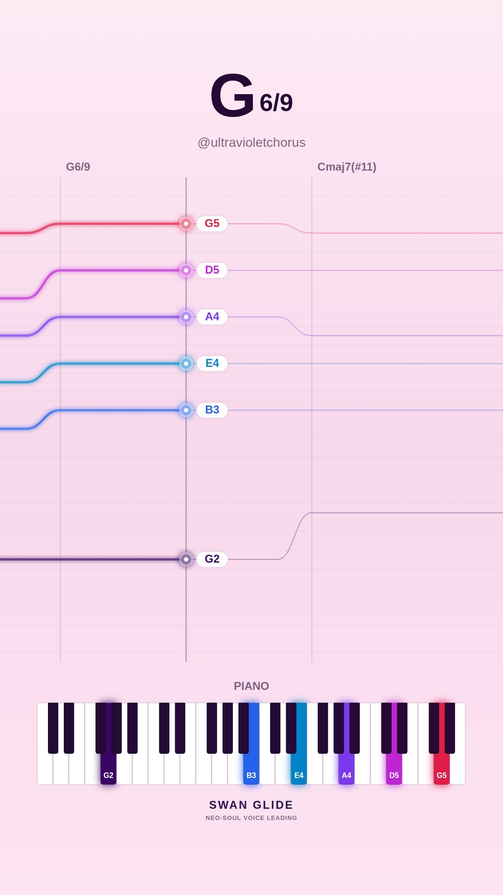
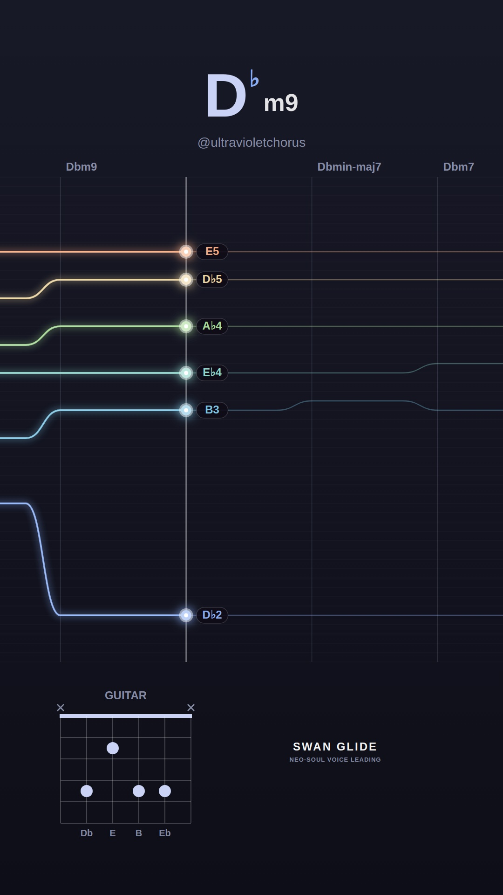
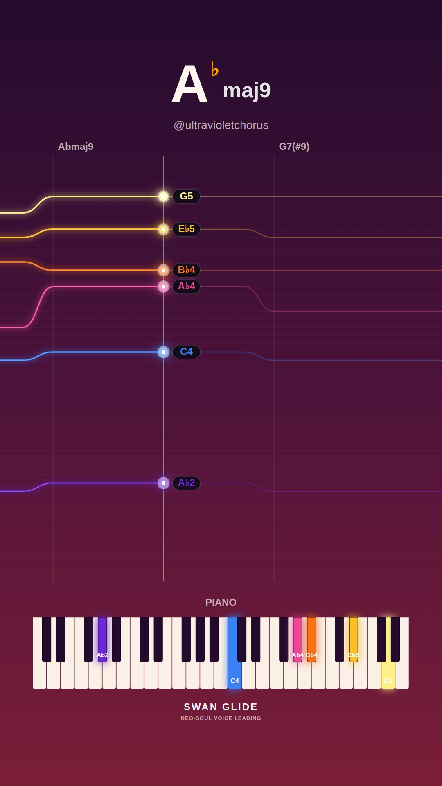
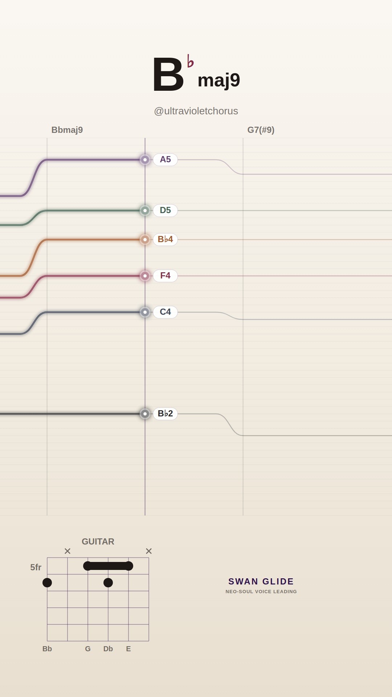
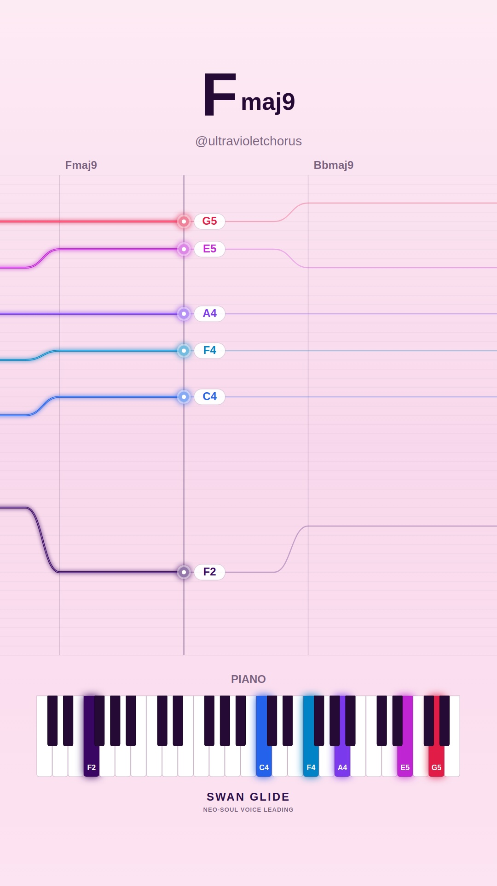
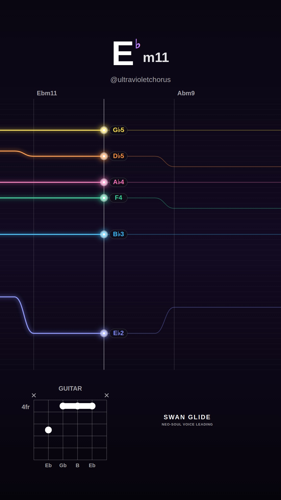
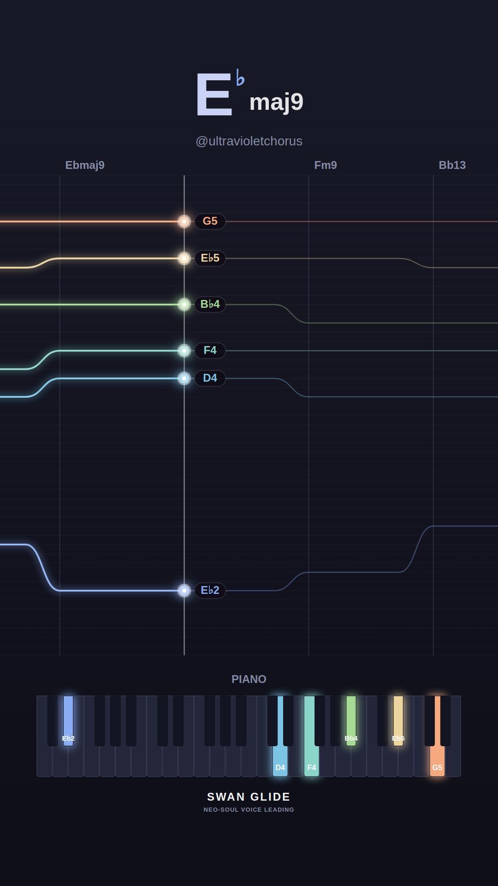
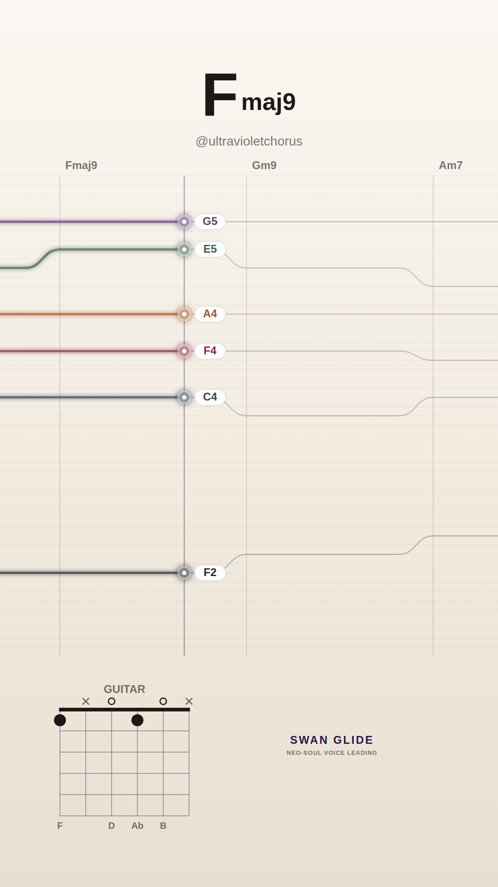
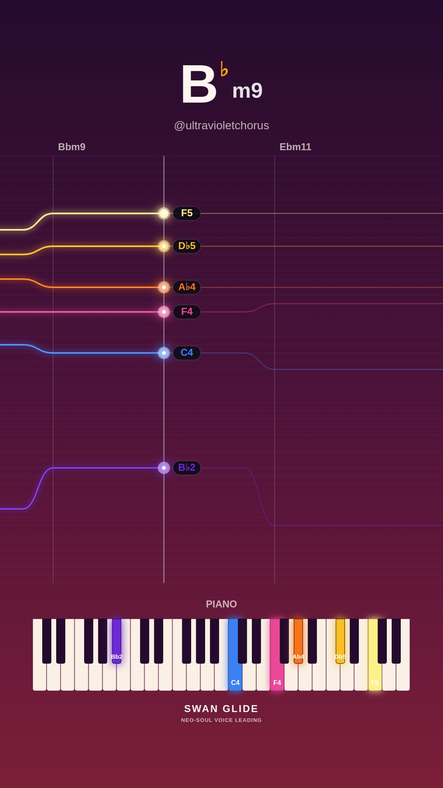

# 🕊️ Swan Glide Visualizers: 2026-11-24

Daily procedural neo-soul video collection featuring authentic voice-leading, harmonic analysis, and lush instrument diagrams.

Total Videos: **10**

| # | Video Preview | Track & Harmony | Instrument & Theme | Chord Progression |
| :---: | :--- | :--- | :--- | :--- |
| **1** |  [▶️ **Watch Video**](./song_1795549559_1_smooth-rnb/video.mp4) | **Smooth Glide (in C)** • Mood: `smooth-rnb` • Key: **C** • Tempo: 69 BPM | 🎸 Guitar 🎨 Preset: `dark` | `Cmaj9` → `Ebmaj9` → `Dm9` → `G13` → `Fm9` → `Cmaj9` |
| **2** |  [▶️ **Watch Video**](./song_1795549611_2_dreamy-major/video.mp4) | **Sunlit Waves (in G)** • Mood: `dreamy-major` • Key: **G** • Tempo: 68 BPM | 🎹 Piano 🎨 Preset: `pastel` | `G6/9` → `Cmaj7(#11)` → `Fmaj9` → `Gmaj9` |
| **3** |  [▶️ **Watch Video**](./song_1795549652_3_melancholy-minor/video.mp4) | **Shadows in Db (in Db)** • Mood: `melancholy-minor` • Key: **Db** • Tempo: 65 BPM | 🎸 Guitar 🎨 Preset: `lofi` | `Dbm9` → `Dbmin-maj7` → `Dbm7` → `Gbm9` → `Ebm7b5` → `Ab7(b13)` → `Dbm11` |
| **4** |  [▶️ **Watch Video**](./song_1795549706_4_spicy-altered/video.mp4) | **Altered Smoke (in Ab)** • Mood: `spicy-altered` • Key: **Ab** • Tempo: 64 BPM | 🎹 Piano 🎨 Preset: `sunset` | `Abmaj9` → `G7(#9)` → `Cm9` → `Bbm9` → `Eb13` → `Abmaj7(#11)` → `G7(b13)` |
| **5** |  [▶️ **Watch Video**](./song_1795549776_5_spicy-altered/video.mp4) | **Spicy Diminished (in Bb)** • Mood: `spicy-altered` • Key: **Bb** • Tempo: 65 BPM | 🎸 Guitar 🎨 Preset: `cream` | `Bbmaj9` → `G7(#9)` → `Cm9` → `F7(alt)` → `B7(b13)` → `Bbmaj7(#11)` |
| **6** |  [▶️ **Watch Video**](./song_1795549836_6_smooth-rnb/video.mp4) | **Warm Rhodes Breeze (in F)** • Mood: `smooth-rnb` • Key: **F** • Tempo: 67 BPM | 🎹 Piano 🎨 Preset: `pastel` | `Fmaj9` → `Bbmaj9` → `Am7` → `Dm9` → `Gm9` → `C13` |
| **7** |  [▶️ **Watch Video**](./song_1795549900_7_melancholy-minor/video.mp4) | **Distant Blue (in Eb)** • Mood: `melancholy-minor` • Key: **Eb** • Tempo: 64 BPM | 🎸 Guitar 🎨 Preset: `dark` | `Ebm11` → `Abm9` → `Db13` → `Gbmaj9` → `Fm7b5` → `Bb7(b13)` |
| **8** |  [▶️ **Watch Video**](./song_1795549966_8_dreamy-major/video.mp4) | **Sunlit Waves (in Eb)** • Mood: `dreamy-major` • Key: **Eb** • Tempo: 67 BPM | 🎹 Piano 🎨 Preset: `lofi` | `Ebmaj9` → `Fm9` → `Bb13` → `Gm7` → `Abmaj7(#11)` |
| **9** |  [▶️ **Watch Video**](./song_1795550009_9_dreamy-major/video.mp4) | **Golden Hour Glow (in F)** • Mood: `dreamy-major` • Key: **F** • Tempo: 65 BPM | 🎸 Guitar 🎨 Preset: `cream` | `Fmaj9` → `Gm9` → `Am7` → `Bbmaj7(#11)` → `Dm9` → `C13` → `Bbmaj9` → `F6/9` |
| **10** |  [▶️ **Watch Video**](./song_1795550074_10_melancholy-minor/video.mp4) | **Paper Lanterns (in Bb)** • Mood: `melancholy-minor` • Key: **Bb** • Tempo: 67 BPM | 🎹 Piano 🎨 Preset: `sunset` | `Bbm9` → `Ebm11` → `Gbmaj7(#11)` → `Cm7b5` → `F7(b13)` |

[← Back to Main Gallery](../README.md)
