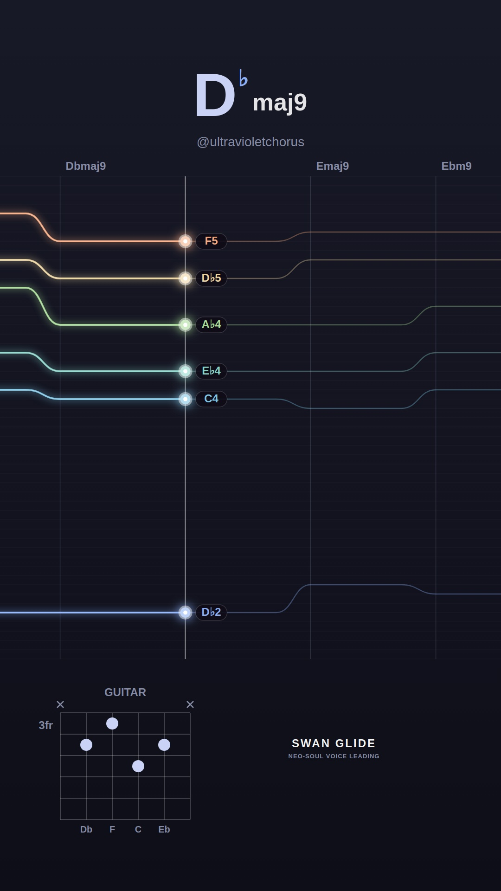
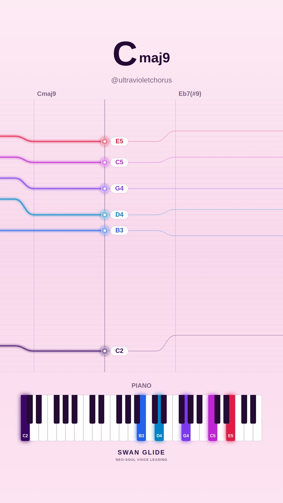
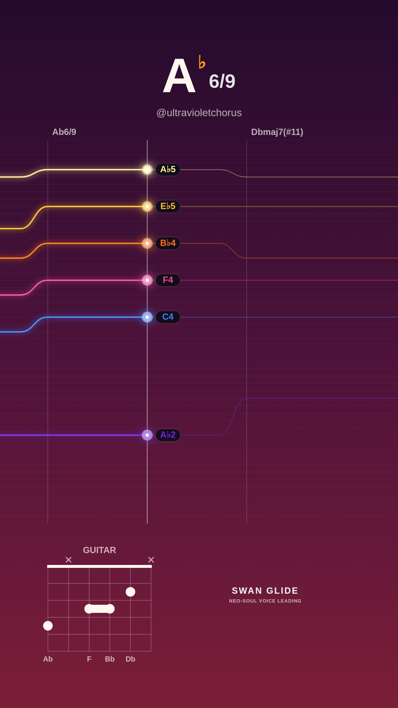
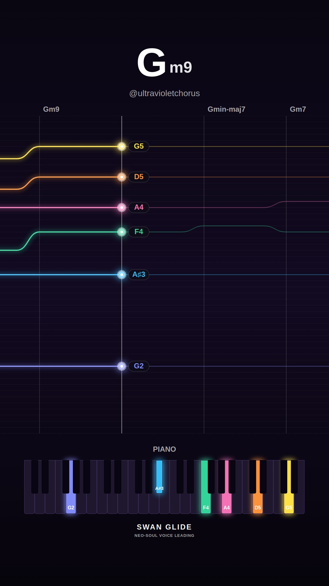
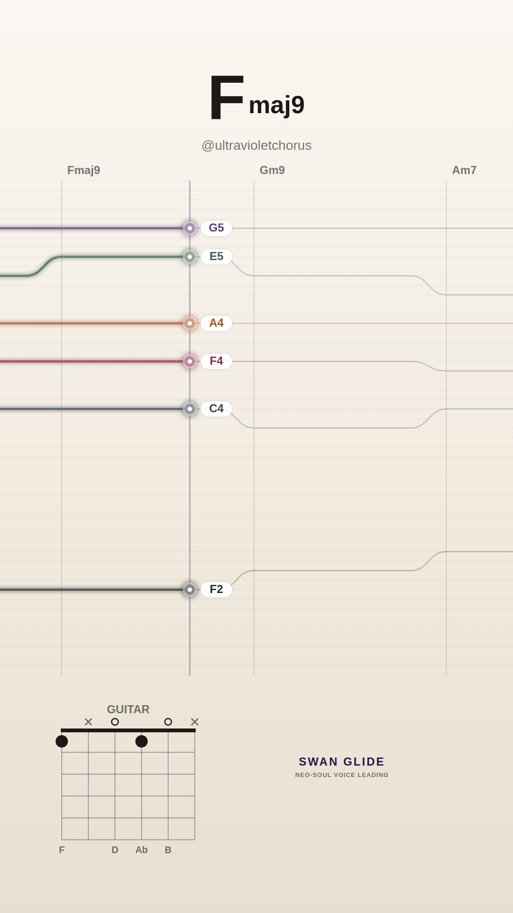
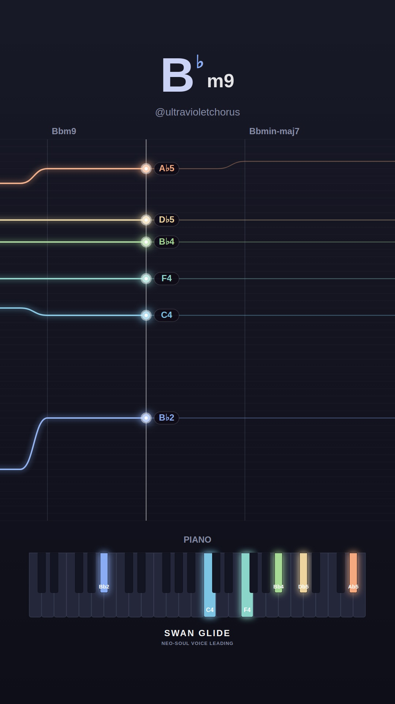
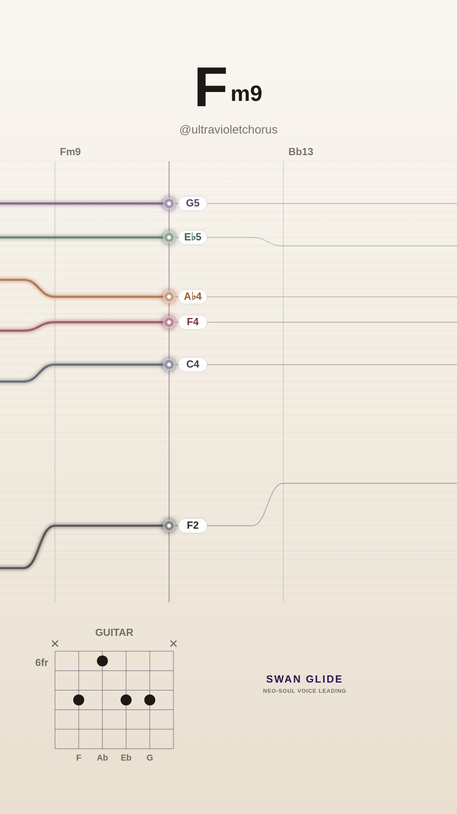
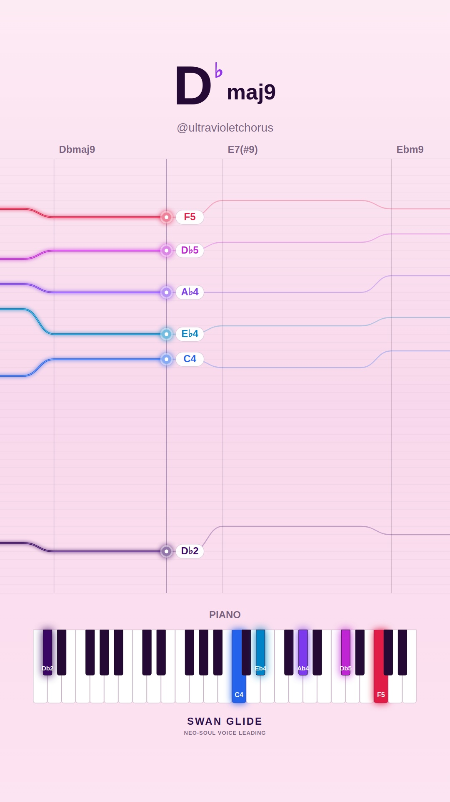
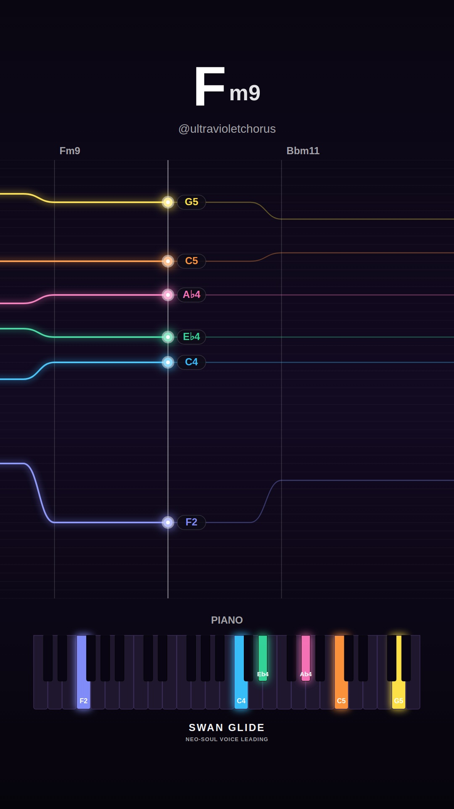

# 🕊️ Swan Glide Video Visualizer Gallery

Automated daily collection of procedural neo-soul jazz visualizers generated with the Swan Glide headless pipeline.

## 📅 Daily Archives
- [**2026-11-16**](./2026-11-16/README.md) (10 videos)
- [**2026-11-15**](./2026-11-15/README.md) (10 videos)
- [**2026-11-14**](./2026-11-14/README.md) (10 videos)
- [**2026-11-13**](./2026-11-13/README.md) (10 videos)
- [**2026-11-12**](./2026-11-12/README.md) (10 videos)
- [**2026-11-10**](./2026-11-10/README.md) (10 videos)
- [**2026-11-09**](./2026-11-09/README.md) (10 videos)
- [**2026-11-08**](./2026-11-08/README.md) (10 videos)
- [**2026-11-07**](./2026-11-07/README.md) (10 videos)
- [**2026-11-06**](./2026-11-06/README.md) (10 videos)
- [**2026-11-05**](./2026-11-05/README.md) (10 videos)
- [**2026-11-04**](./2026-11-04/README.md) (4 videos)

## ✨ Latest Daily Showcase (2026-11-16)

| # | Video Preview | Track & Harmony | Instrument & Theme | Chord Progression |
| :---: | :--- | :--- | :--- | :--- |
| **1** |  [▶️ **Watch Video**](./2026-11-16/song_1794855584_1_smooth-rnb/video.mp4) | **Silk & Honey (in Db)** • Mood: `smooth-rnb` • Key: **Db** • Tempo: 69 BPM | 🎸 Guitar 🎨 Preset: `lofi` | `Dbmaj9` → `Emaj9` → `Ebm9` → `Ab13` → `Gbm9` → `Dbmaj9` |
| **2** |  [▶️ **Watch Video**](./2026-11-16/song_1794855637_2_spicy-altered/video.mp4) | **Neon Midnight (in C)** • Mood: `spicy-altered` • Key: **C** • Tempo: 66 BPM | 🎹 Piano 🎨 Preset: `pastel` | `Cmaj9` → `Eb7(#9)` → `Dm9` → `Db7(b13)` |
| **3** |  [▶️ **Watch Video**](./2026-11-16/song_1794855679_3_dreamy-major/video.mp4) | **Morning Silk (in Ab)** • Mood: `dreamy-major` • Key: **Ab** • Tempo: 68 BPM | 🎸 Guitar 🎨 Preset: `sunset` | `Ab6/9` → `Dbmaj7(#11)` → `Gbmaj9` → `Abmaj9` |
| **4** |  [▶️ **Watch Video**](./2026-11-16/song_1794855720_4_melancholy-minor/video.mp4) | **Midnight Reverie (in G)** • Mood: `melancholy-minor` • Key: **G** • Tempo: 65 BPM | 🎹 Piano 🎨 Preset: `dark` | `Gm9` → `Gmin-maj7` → `Gm7` → `Cm9` → `Am7b5` → `D7(b13)` → `Gm11` |
| **5** |  [▶️ **Watch Video**](./2026-11-16/song_1794855776_5_dreamy-major/video.mp4) | **Celestial Drift (in F)** • Mood: `dreamy-major` • Key: **F** • Tempo: 65 BPM | 🎸 Guitar 🎨 Preset: `cream` | `Fmaj9` → `Gm9` → `Am7` → `Bbmaj7(#11)` → `Dm9` → `C13` → `Bbmaj9` → `F6/9` |
| **6** |  [▶️ **Watch Video**](./2026-11-16/song_1794855840_6_melancholy-minor/video.mp4) | **Quiet Solitude (in Bb)** • Mood: `melancholy-minor` • Key: **Bb** • Tempo: 65 BPM | 🎹 Piano 🎨 Preset: `lofi` | `Bbm9` → `Bbmin-maj7` → `Bbm7` → `Ebm9` |
| **7** |  [▶️ **Watch Video**](./2026-11-16/song_1794855883_7_smooth-rnb/video.mp4) | **Late Night Call (in Eb)** • Mood: `smooth-rnb` • Key: **Eb** • Tempo: 72 BPM | 🎸 Guitar 🎨 Preset: `cream` | `Fm9` → `Bb13` → `Ebmaj9` → `C7(#9)` |
| **8** |  [▶️ **Watch Video**](./2026-11-16/song_1794855920_8_spicy-altered/video.mp4) | **Neon Midnight (in Db)** • Mood: `spicy-altered` • Key: **Db** • Tempo: 70 BPM | 🎹 Piano 🎨 Preset: `pastel` | `Dbmaj9` → `E7(#9)` → `Ebm9` → `Ab7(#9)` → `Fm9` → `Bb7(b13)` → `Ebm9` → `D7(b13)` |
| **9** |  [▶️ **Watch Video**](./2026-11-16/song_1794855983_9_dreamy-major/video.mp4) | **Golden Hour Glow (in Bb)** • Mood: `dreamy-major` • Key: **Bb** • Tempo: 65 BPM | 🎸 Guitar 🎨 Preset: `sunset` | `Bbmaj9` → `Ebmaj7(#11)` → `Dm7` → `Gm9` |
| **10** |  [▶️ **Watch Video**](./2026-11-16/song_1794856025_10_melancholy-minor/video.mp4) | **Quiet Solitude (in F)** • Mood: `melancholy-minor` • Key: **F** • Tempo: 67 BPM | 🎹 Piano 🎨 Preset: `dark` | `Fm9` → `Bbm11` → `Dbmaj7(#11)` → `Gm7b5` → `C7(b13)` |

*All videos rendered at 1080x1920 60FPS with 48kHz synthesized audio.*
