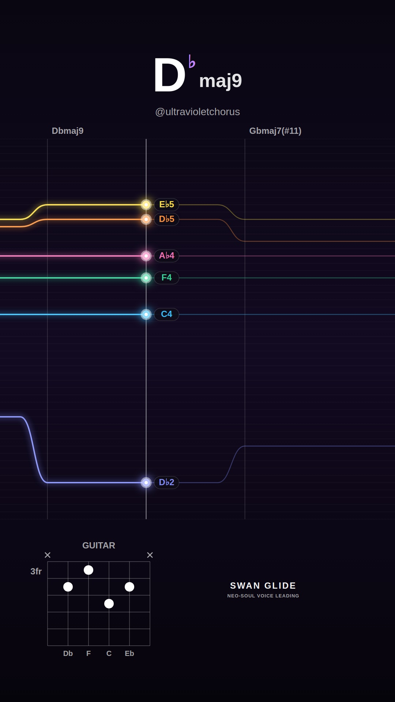
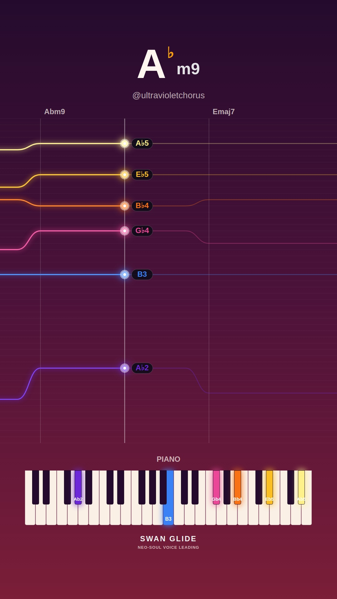
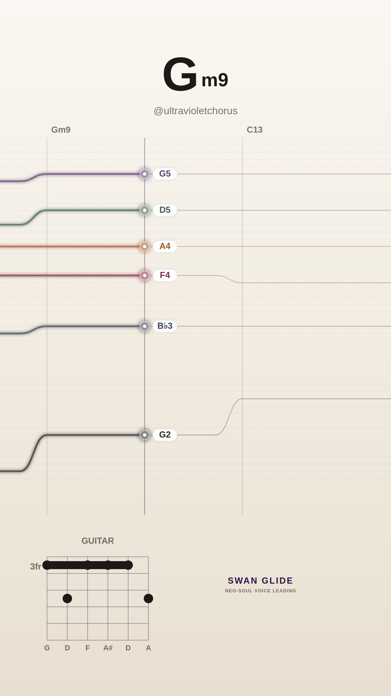
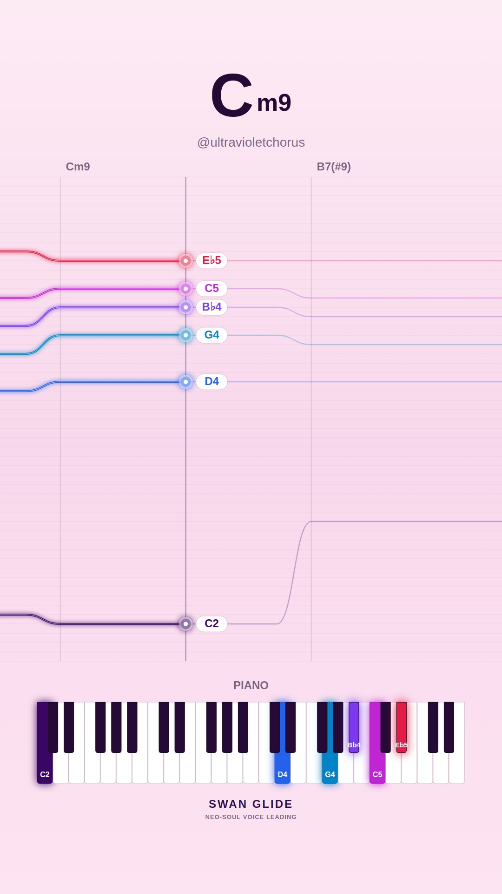
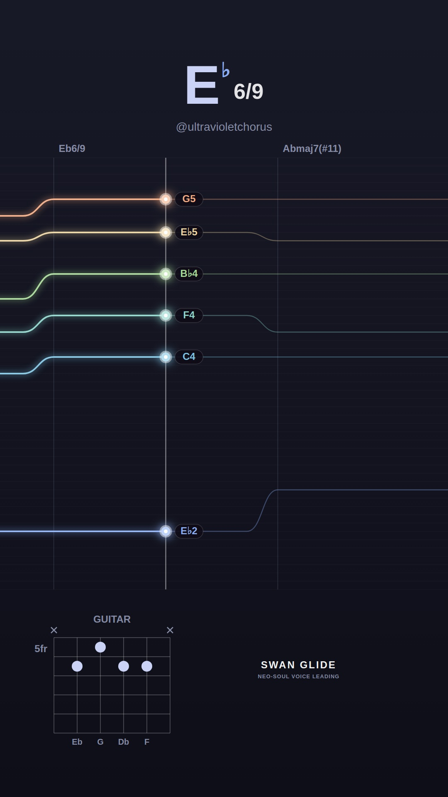
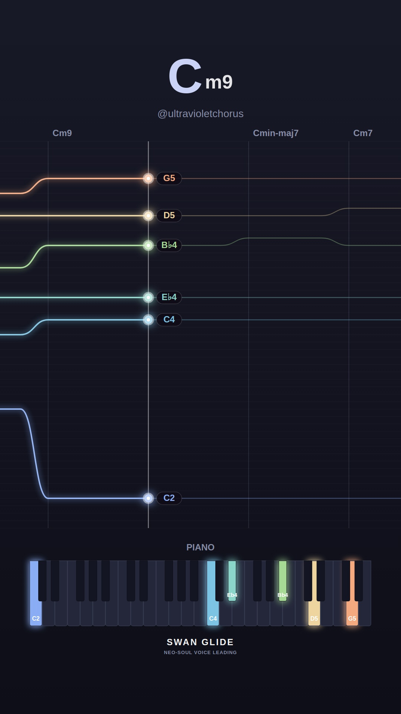
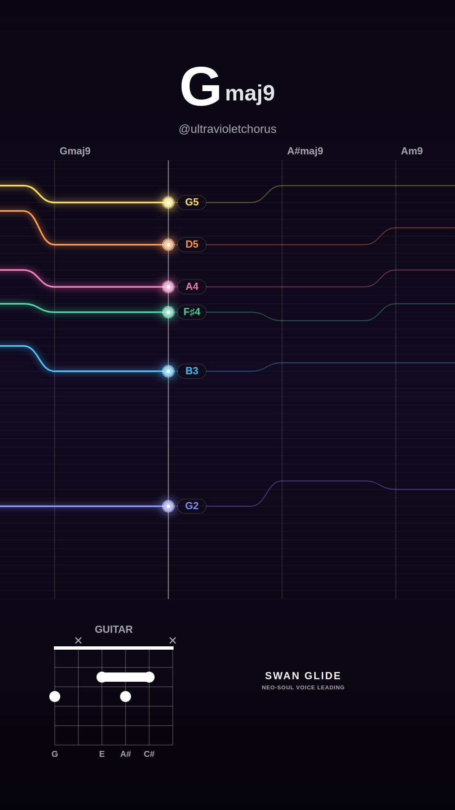
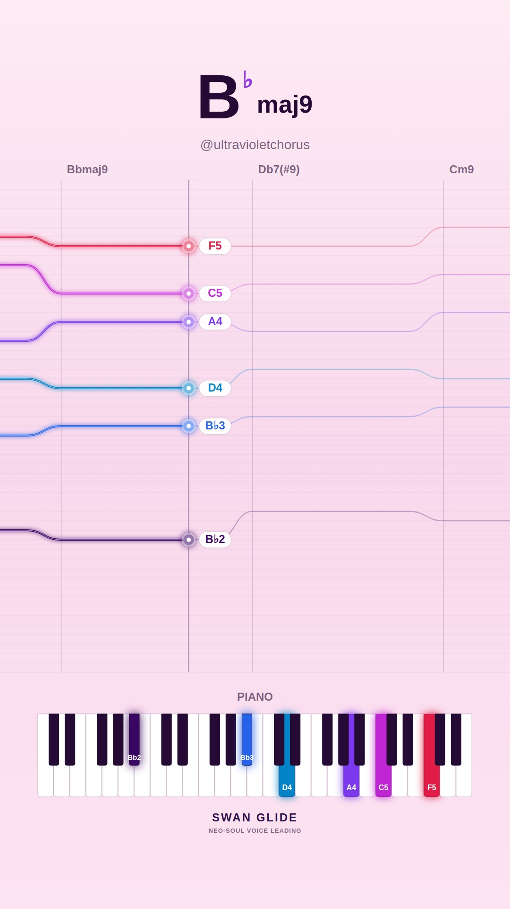
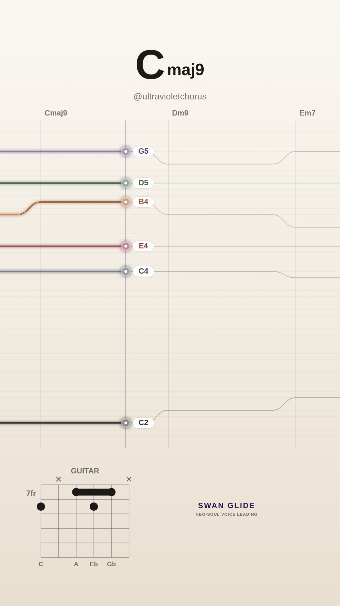
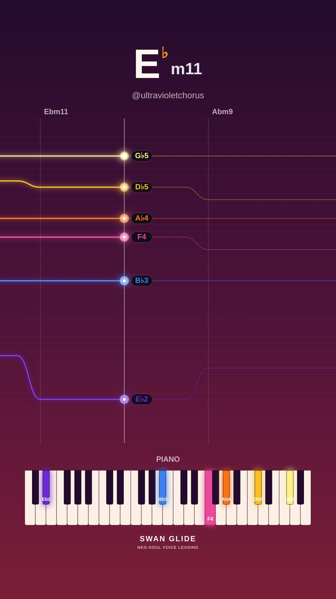

# 🕊️ Swan Glide Video Visualizer Gallery

Automated daily collection of procedural neo-soul jazz visualizers generated with the Swan Glide headless pipeline.

## 📅 Daily Archives
- [**2026-11-15**](./2026-11-15/README.md) (10 videos)
- [**2026-11-14**](./2026-11-14/README.md) (10 videos)
- [**2026-11-13**](./2026-11-13/README.md) (10 videos)
- [**2026-11-12**](./2026-11-12/README.md) (10 videos)
- [**2026-11-10**](./2026-11-10/README.md) (10 videos)
- [**2026-11-09**](./2026-11-09/README.md) (10 videos)
- [**2026-11-08**](./2026-11-08/README.md) (10 videos)
- [**2026-11-07**](./2026-11-07/README.md) (10 videos)
- [**2026-11-06**](./2026-11-06/README.md) (10 videos)
- [**2026-11-05**](./2026-11-05/README.md) (10 videos)
- [**2026-11-04**](./2026-11-04/README.md) (4 videos)

## ✨ Latest Daily Showcase (2026-11-15)

| # | Video Preview | Track & Harmony | Instrument & Theme | Chord Progression |
| :---: | :--- | :--- | :--- | :--- |
| **1** |  [▶️ **Watch Video**](./2026-11-15/song_1794758211_1_dreamy-major/video.mp4) | **Lydian Shimmer (in Db)** • Mood: `dreamy-major` • Key: **Db** • Tempo: 65 BPM | 🎸 Guitar 🎨 Preset: `dark` | `Dbmaj9` → `Gbmaj7(#11)` → `Fm7` → `Bbm9` |
| **2** |  [▶️ **Watch Video**](./2026-11-15/song_1794758255_2_melancholy-minor/video.mp4) | **Paper Lanterns (in Ab)** • Mood: `melancholy-minor` • Key: **Ab** • Tempo: 66 BPM | 🎹 Piano 🎨 Preset: `sunset` | `Abm9` → `Emaj7` → `Bbm7b5` → `Eb7(b13)` |
| **3** |  [▶️ **Watch Video**](./2026-11-15/song_1794758300_3_smooth-rnb/video.mp4) | **Sunday Sunset (in F)** • Mood: `smooth-rnb` • Key: **F** • Tempo: 72 BPM | 🎸 Guitar 🎨 Preset: `cream` | `Gm9` → `C13` → `Fmaj9` → `D7(#9)` |
| **4** |  [▶️ **Watch Video**](./2026-11-15/song_1794758337_4_spicy-altered/video.mp4) | **After Hours Jazz (in Bb)** • Mood: `spicy-altered` • Key: **Bb** • Tempo: 68 BPM | 🎹 Piano 🎨 Preset: `pastel` | `Cm9` → `B7(#9)` → `Bbmaj9` → `G7(b13)` → `Db7(#9)` |
| **5** |  [▶️ **Watch Video**](./2026-11-15/song_1794758380_5_dreamy-major/video.mp4) | **Celestial Drift (in Eb)** • Mood: `dreamy-major` • Key: **Eb** • Tempo: 68 BPM | 🎸 Guitar 🎨 Preset: `lofi` | `Eb6/9` → `Abmaj7(#11)` → `Dbmaj9` → `Ebmaj9` |
| **6** |  [▶️ **Watch Video**](./2026-11-15/song_1794758421_6_melancholy-minor/video.mp4) | **Midnight Reverie (in C)** • Mood: `melancholy-minor` • Key: **C** • Tempo: 65 BPM | 🎹 Piano 🎨 Preset: `lofi` | `Cm9` → `Cmin-maj7` → `Cm7` → `Fm9` → `Dm7b5` → `G7(b13)` → `Cm11` |
| **7** |  [▶️ **Watch Video**](./2026-11-15/song_1794758478_7_smooth-rnb/video.mp4) | **Late Night Call (in G)** • Mood: `smooth-rnb` • Key: **G** • Tempo: 69 BPM | 🎸 Guitar 🎨 Preset: `dark` | `Gmaj9` → `A#maj9` → `Am9` → `D13` → `Cm9` → `Gmaj9` |
| **8** |  [▶️ **Watch Video**](./2026-11-15/song_1794758529_8_spicy-altered/video.mp4) | **Neon Midnight (in Bb)** • Mood: `spicy-altered` • Key: **Bb** • Tempo: 70 BPM | 🎹 Piano 🎨 Preset: `pastel` | `Bbmaj9` → `Db7(#9)` → `Cm9` → `F7(#9)` → `Dm9` → `G7(b13)` → `Cm9` → `B7(b13)` |
| **9** |  [▶️ **Watch Video**](./2026-11-15/song_1794758593_9_dreamy-major/video.mp4) | **Lydian Shimmer (in C)** • Mood: `dreamy-major` • Key: **C** • Tempo: 65 BPM | 🎸 Guitar 🎨 Preset: `cream` | `Cmaj9` → `Dm9` → `Em7` → `Fmaj7(#11)` → `Am9` → `G13` → `Fmaj9` → `C6/9` |
| **10** |  [▶️ **Watch Video**](./2026-11-15/song_1794758657_10_melancholy-minor/video.mp4) | **Distant Blue (in Eb)** • Mood: `melancholy-minor` • Key: **Eb** • Tempo: 64 BPM | 🎹 Piano 🎨 Preset: `sunset` | `Ebm11` → `Abm9` → `Db13` → `Gbmaj9` → `Fm7b5` → `Bb7(b13)` |

*All videos rendered at 1080x1920 60FPS with 48kHz synthesized audio.*
