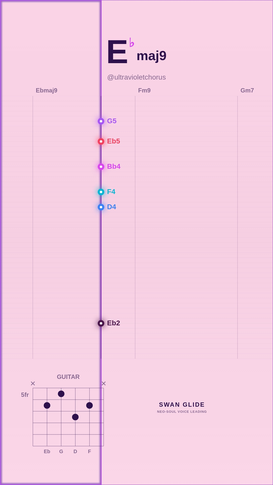
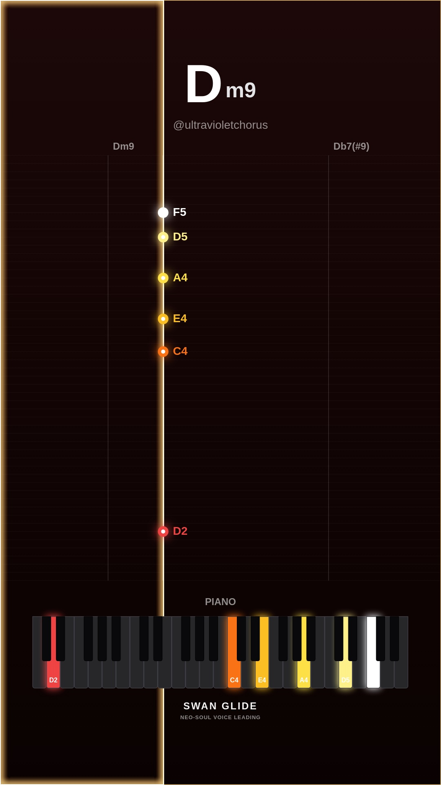
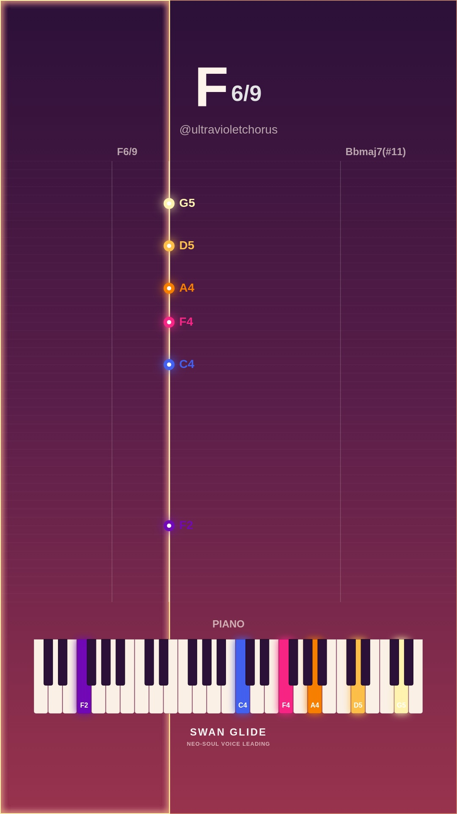
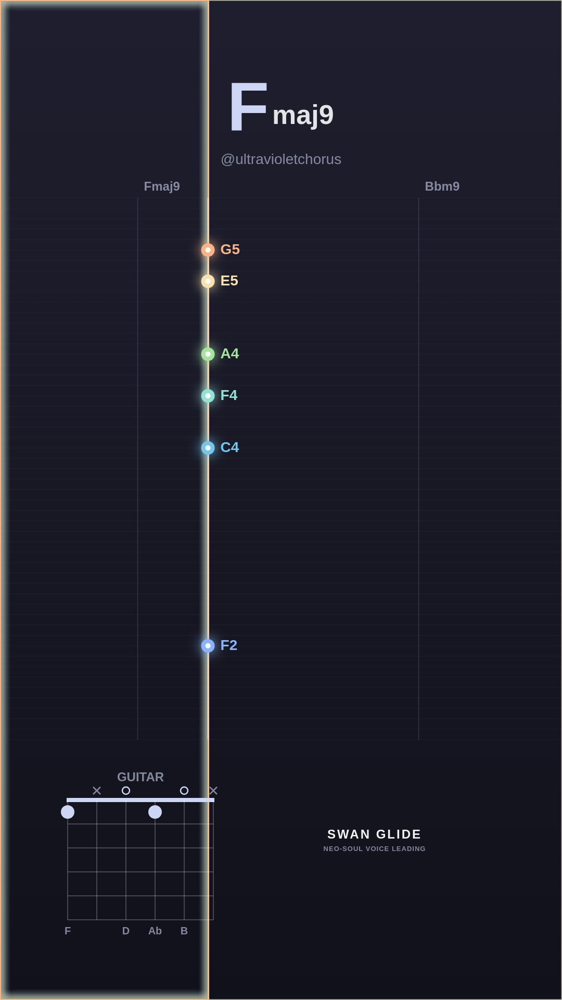

# 🕊️ Swan Glide Video Visualizer Gallery

Automated daily collection of procedural neo-soul jazz visualizers generated with the Swan Glide headless pipeline.

## 📅 Daily Archives
- [**2026-11-04**](./2026-11-04/README.md) (4 videos)

## ✨ Latest Daily Showcase (2026-11-04)

| # | Video Preview | Track & Harmony | Instrument & Theme | Chord Progression |
| :---: | :--- | :--- | :--- | :--- |
| **1** |  [▶️ **Watch Video**](./2026-11-04/song_1793798222_dreamy-major/video.mp4) | **Celestial Drift (in Eb)** • Mood: `dreamy-major` • Key: **Eb** • Tempo: 65 BPM | 🎸 Guitar 🎨 Preset: `pastel` | `Ebmaj9` → `Fm9` → `Gm7` → `Abmaj7(#11)` → `Cm9` → `Bb13` → `Abmaj9` → `Eb6/9` |
| **2** |  [▶️ **Watch Video**](./2026-11-04/song_1793798352_spicy-altered/video.mp4) | **Neon Midnight (in C)** • Mood: `spicy-altered` • Key: **C** • Tempo: 68 BPM | 🎹 Piano 🎨 Preset: `dark` | `Dm9` → `Db7(#9)` → `Cmaj9` → `A7(b13)` → `Eb7(#9)` |
| **3** |  [▶️ **Watch Video**](./2026-11-04/song_1793798449_dreamy-major/video.mp4) | **Celestial Drift (in F)** • Mood: `dreamy-major` • Key: **F** • Tempo: 68 BPM | 🎹 Piano 🎨 Preset: `sunset` | `F6/9` → `Bbmaj7(#11)` → `Ebmaj9` → `Fmaj9` |
| **4** |  [▶️ **Watch Video**](./2026-11-04/song_1793798491_smooth-rnb/video.mp4) | **Warm Rhodes Breeze (in F)** • Mood: `smooth-rnb` • Key: **F** • Tempo: 70 BPM | 🎸 Guitar 🎨 Preset: `lofi` | `Fmaj9` → `Bbm9` → `Eb13` → `Fmaj9` |

*All videos rendered at 1080x1920 60FPS with 48kHz synthesized audio.*
