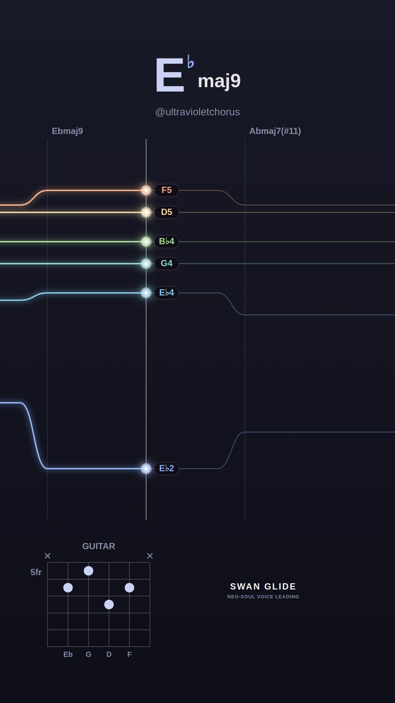
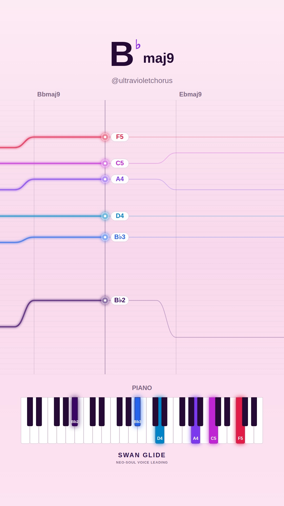
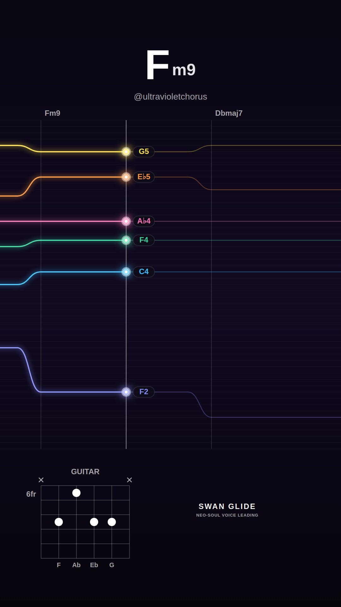
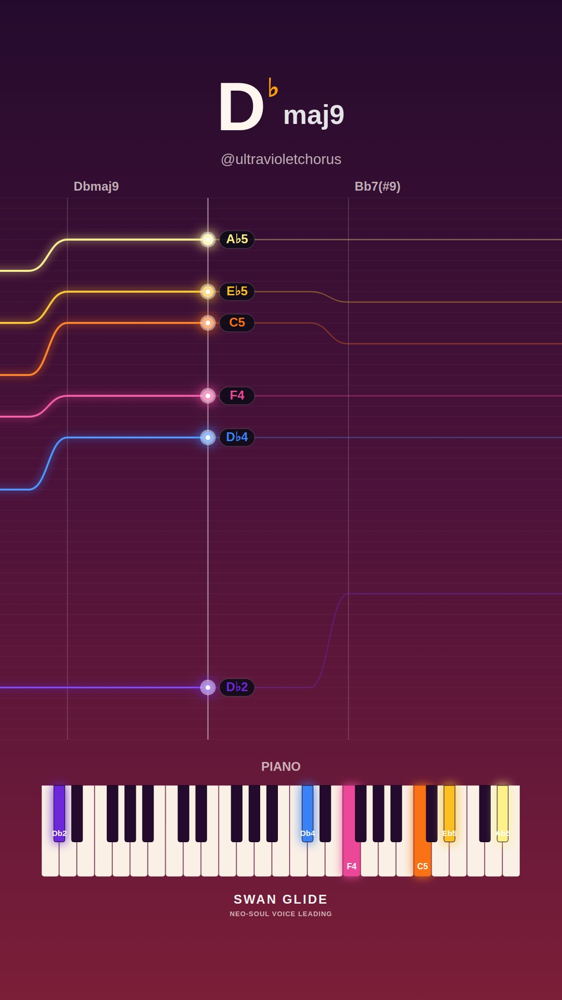
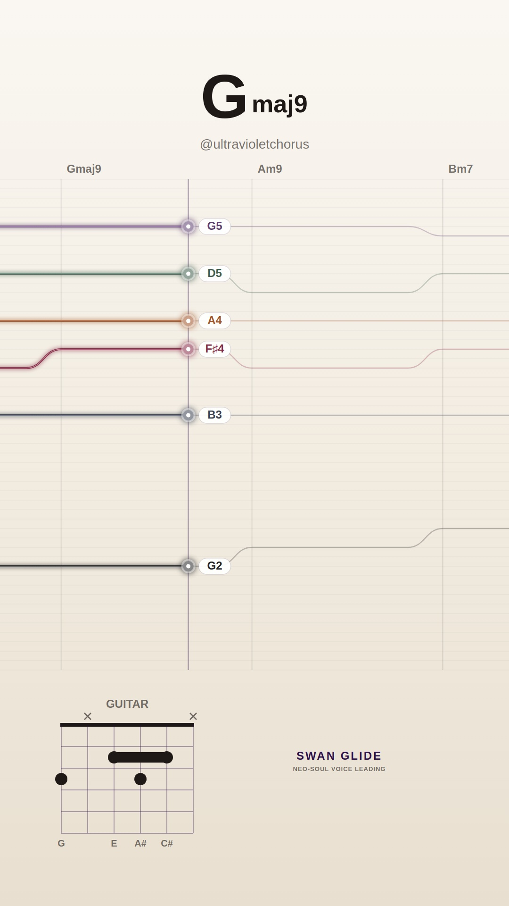
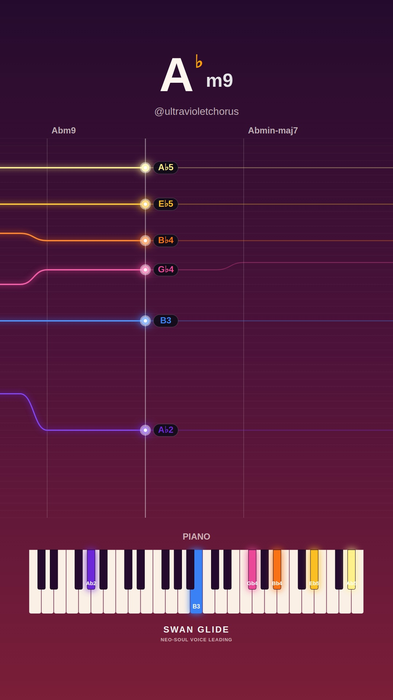
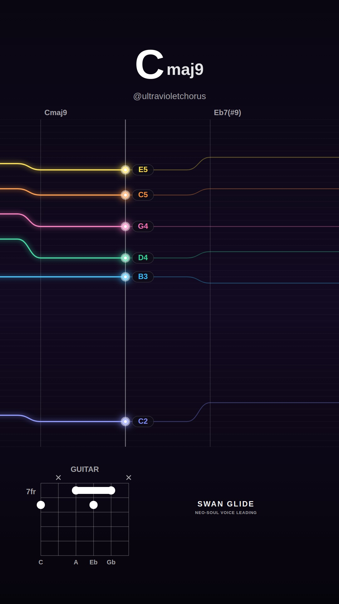
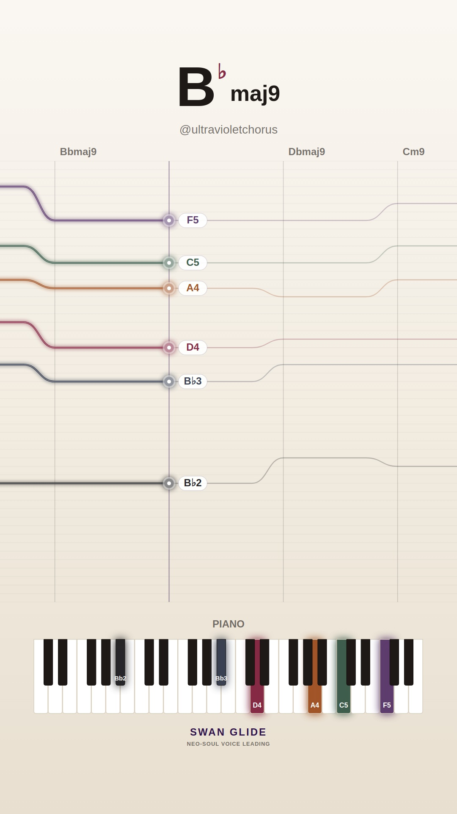
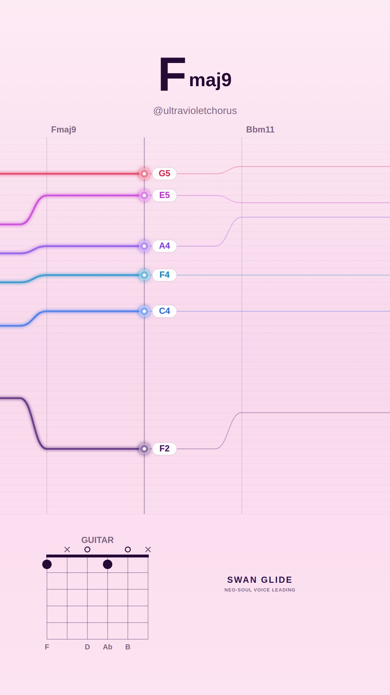
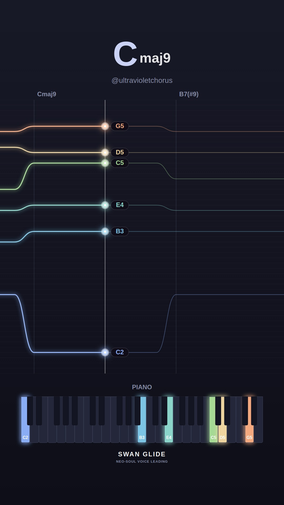

# 🕊️ Swan Glide Video Visualizer Gallery

Automated daily collection of procedural neo-soul jazz visualizers generated with the Swan Glide headless pipeline.

## 📅 Daily Archives
- [**2026-11-09**](./2026-11-09/README.md) (10 videos)
- [**2026-11-08**](./2026-11-08/README.md) (10 videos)
- [**2026-11-07**](./2026-11-07/README.md) (10 videos)
- [**2026-11-06**](./2026-11-06/README.md) (10 videos)
- [**2026-11-05**](./2026-11-05/README.md) (10 videos)
- [**2026-11-04**](./2026-11-04/README.md) (4 videos)

## ✨ Latest Daily Showcase (2026-11-09)

| # | Video Preview | Track & Harmony | Instrument & Theme | Chord Progression |
| :---: | :--- | :--- | :--- | :--- |
| **1** |  [▶️ **Watch Video**](./2026-11-09/song_1794251791_1_dreamy-major/video.mp4) | **Morning Silk (in Eb)** • Mood: `dreamy-major` • Key: **Eb** • Tempo: 65 BPM | 🎸 Guitar 🎨 Preset: `lofi` | `Ebmaj9` → `Abmaj7(#11)` → `Gm7` → `Cm9` |
| **2** |  [▶️ **Watch Video**](./2026-11-09/song_1794251820_2_smooth-rnb/video.mp4) | **Warm Rhodes Breeze (in Bb)** • Mood: `smooth-rnb` • Key: **Bb** • Tempo: 67 BPM | 🎹 Piano 🎨 Preset: `pastel` | `Bbmaj9` → `Ebmaj9` → `Dm7` → `Gm9` → `Cm9` → `F13` |
| **3** |  [▶️ **Watch Video**](./2026-11-09/song_1794251866_3_melancholy-minor/video.mp4) | **Distant Blue (in F)** • Mood: `melancholy-minor` • Key: **F** • Tempo: 66 BPM | 🎸 Guitar 🎨 Preset: `dark` | `Fm9` → `Dbmaj7` → `Gm7b5` → `C7(b13)` |
| **4** |  [▶️ **Watch Video**](./2026-11-09/song_1794251896_4_spicy-altered/video.mp4) | **Altered Smoke (in Db)** • Mood: `spicy-altered` • Key: **Db** • Tempo: 65 BPM | 🎹 Piano 🎨 Preset: `sunset` | `Dbmaj9` → `Bb7(#9)` → `Ebm9` → `Ab7(alt)` → `D7(b13)` → `Dbmaj7(#11)` |
| **5** |  [▶️ **Watch Video**](./2026-11-09/song_1794251941_5_dreamy-major/video.mp4) | **Morning Silk (in G)** • Mood: `dreamy-major` • Key: **G** • Tempo: 65 BPM | 🎸 Guitar 🎨 Preset: `cream` | `Gmaj9` → `Am9` → `Bm7` → `Cmaj7(#11)` → `Em9` → `D13` → `Cmaj9` → `G6/9` |
| **6** |  [▶️ **Watch Video**](./2026-11-09/song_1794251984_6_melancholy-minor/video.mp4) | **Shadows in Db (in Ab)** • Mood: `melancholy-minor` • Key: **Ab** • Tempo: 65 BPM | 🎹 Piano 🎨 Preset: `sunset` | `Abm9` → `Abmin-maj7` → `Abm7` → `Dbm9` |
| **7** |  [▶️ **Watch Video**](./2026-11-09/song_1794252014_7_spicy-altered/video.mp4) | **Tritone Whispers (in C)** • Mood: `spicy-altered` • Key: **C** • Tempo: 66 BPM | 🎸 Guitar 🎨 Preset: `dark` | `Cmaj9` → `Eb7(#9)` → `Dm9` → `Db7(b13)` |
| **8** |  [▶️ **Watch Video**](./2026-11-09/song_1794252044_8_smooth-rnb/video.mp4) | **Slow Motion Love (in Bb)** • Mood: `smooth-rnb` • Key: **Bb** • Tempo: 69 BPM | 🎹 Piano 🎨 Preset: `cream` | `Bbmaj9` → `Dbmaj9` → `Cm9` → `F13` → `Ebm9` → `Bbmaj9` |
| **9** |  [▶️ **Watch Video**](./2026-11-09/song_1794252080_9_smooth-rnb/video.mp4) | **Warm Rhodes Breeze (in F)** • Mood: `smooth-rnb` • Key: **F** • Tempo: 73 BPM | 🎸 Guitar 🎨 Preset: `pastel` | `Fmaj9` → `Bbm11` → `Eb13` → `Gm9` → `C7(b13)` |
| **10** |  [▶️ **Watch Video**](./2026-11-09/song_1794252110_10_spicy-altered/video.mp4) | **Chromatic Glide (in C)** • Mood: `spicy-altered` • Key: **C** • Tempo: 64 BPM | 🎹 Piano 🎨 Preset: `lofi` | `Cmaj9` → `B7(#9)` → `Em9` → `Dm9` → `G13` → `Cmaj7(#11)` → `B7(b13)` |

*All videos rendered at 1080x1920 60FPS with 48kHz synthesized audio.*
