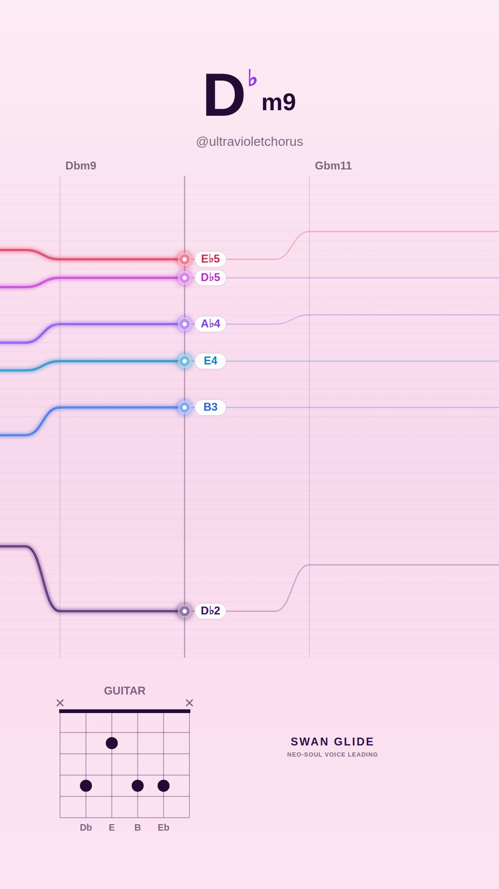
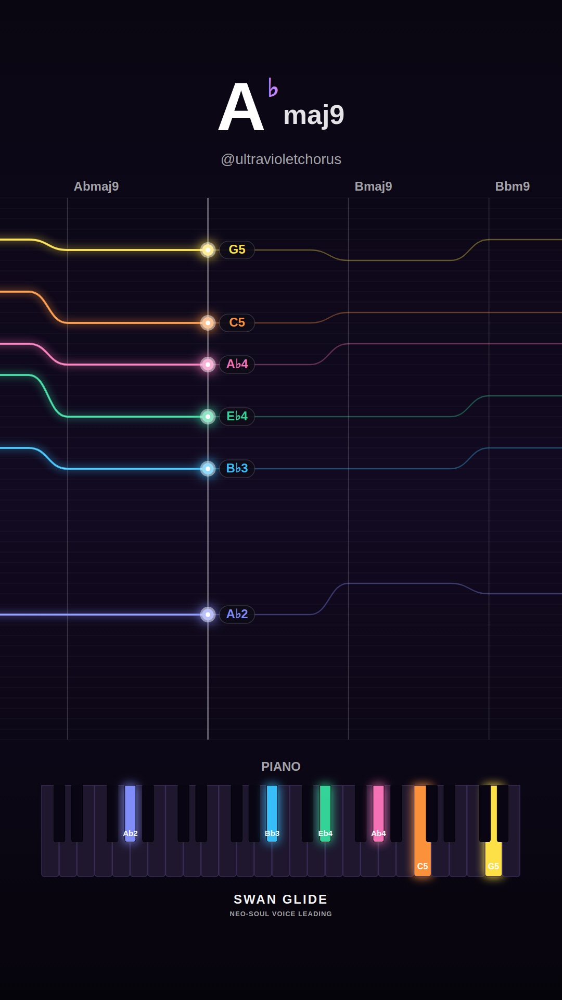
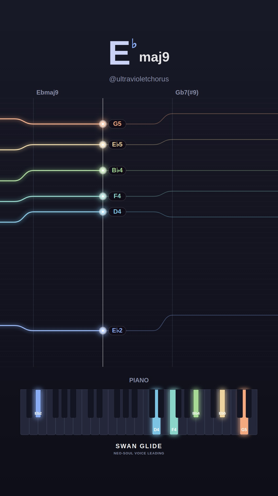
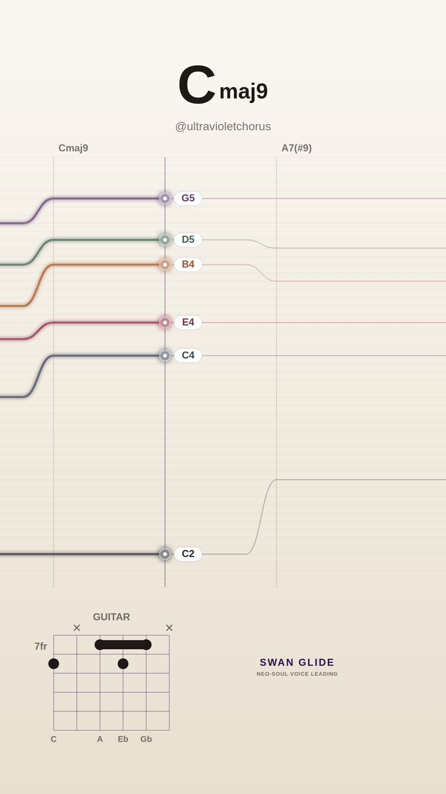
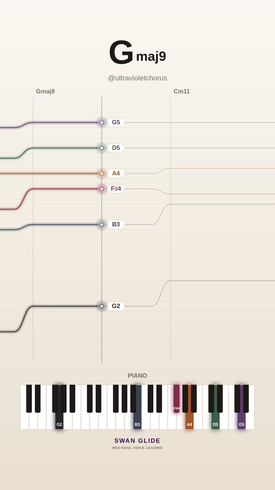
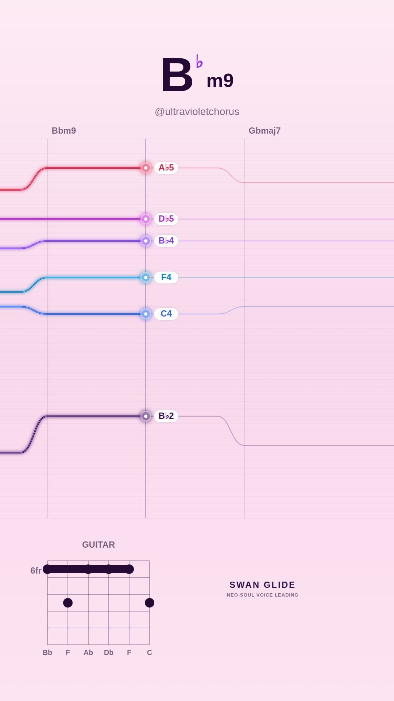
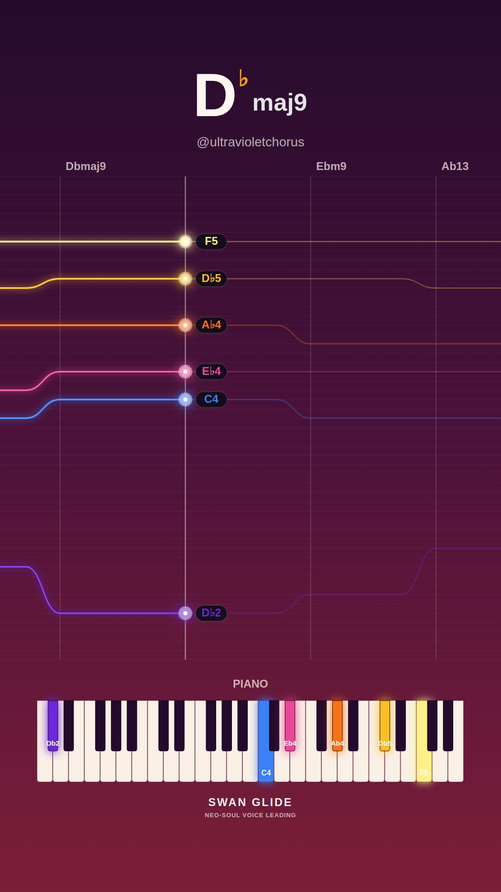
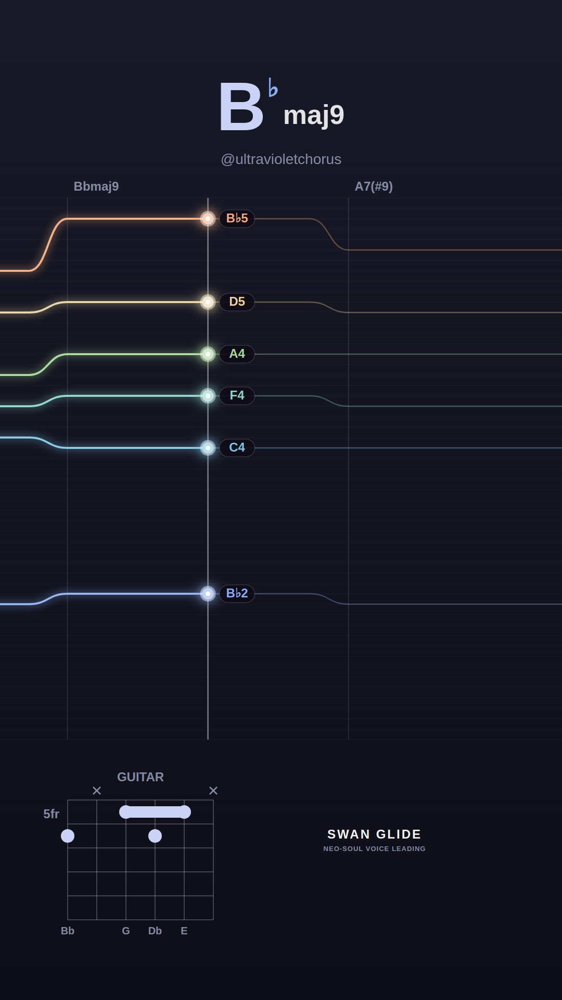
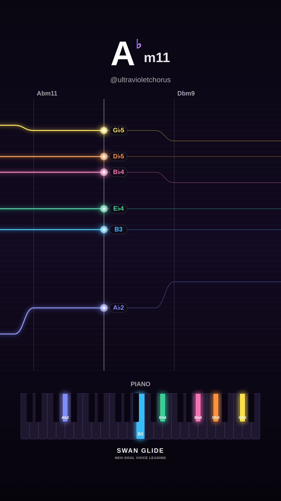

# 🕊️ Swan Glide Video Visualizer Gallery

Automated daily collection of procedural neo-soul jazz visualizers generated with the Swan Glide headless pipeline.

## 📅 Daily Archives
- [**2026-11-13**](./2026-11-13/README.md) (10 videos)
- [**2026-11-12**](./2026-11-12/README.md) (10 videos)
- [**2026-11-10**](./2026-11-10/README.md) (10 videos)
- [**2026-11-09**](./2026-11-09/README.md) (10 videos)
- [**2026-11-08**](./2026-11-08/README.md) (10 videos)
- [**2026-11-07**](./2026-11-07/README.md) (10 videos)
- [**2026-11-06**](./2026-11-06/README.md) (10 videos)
- [**2026-11-05**](./2026-11-05/README.md) (10 videos)
- [**2026-11-04**](./2026-11-04/README.md) (4 videos)

## ✨ Latest Daily Showcase (2026-11-13)

| # | Video Preview | Track & Harmony | Instrument & Theme | Chord Progression |
| :---: | :--- | :--- | :--- | :--- |
| **1** |  [▶️ **Watch Video**](./2026-11-13/song_1794588619_1_melancholy-minor/video.mp4) | **Quiet Solitude (in Db)** • Mood: `melancholy-minor` • Key: **Db** • Tempo: 67 BPM | 🎸 Guitar 🎨 Preset: `pastel` | `Dbm9` → `Gbm11` → `Amaj7(#11)` → `Ebm7b5` → `Ab7(b13)` |
| **2** |  [▶️ **Watch Video**](./2026-11-13/song_1794588659_2_smooth-rnb/video.mp4) | **Smooth Glide (in Ab)** • Mood: `smooth-rnb` • Key: **Ab** • Tempo: 69 BPM | 🎹 Piano 🎨 Preset: `dark` | `Abmaj9` → `Bmaj9` → `Bbm9` → `Eb13` → `Dbm9` → `Abmaj9` |
| **3** |  [▶️ **Watch Video**](./2026-11-13/song_1794588702_3_dreamy-major/video.mp4) | **Celestial Drift (in F)** • Mood: `dreamy-major` • Key: **F** • Tempo: 65 BPM | 🎸 Guitar 🎨 Preset: `sunset` | `Fmaj9` → `Bbmaj7(#11)` → `Am7` → `Dm9` |
| **4** |  [▶️ **Watch Video**](./2026-11-13/song_1794588736_4_spicy-altered/video.mp4) | **Altered Smoke (in Eb)** • Mood: `spicy-altered` • Key: **Eb** • Tempo: 66 BPM | 🎹 Piano 🎨 Preset: `lofi` | `Ebmaj9` → `Gb7(#9)` → `Fm9` → `E7(b13)` |
| **5** |  [▶️ **Watch Video**](./2026-11-13/song_1794588771_5_spicy-altered/video.mp4) | **After Hours Jazz (in C)** • Mood: `spicy-altered` • Key: **C** • Tempo: 65 BPM | 🎸 Guitar 🎨 Preset: `cream` | `Cmaj9` → `A7(#9)` → `Dm9` → `G7(alt)` → `Db7(b13)` → `Cmaj7(#11)` |
| **6** |  [▶️ **Watch Video**](./2026-11-13/song_1794588818_6_smooth-rnb/video.mp4) | **Silk & Honey (in G)** • Mood: `smooth-rnb` • Key: **G** • Tempo: 73 BPM | 🎹 Piano 🎨 Preset: `cream` | `Gmaj9` → `Cm11` → `F13` → `Am9` → `D7(b13)` |
| **7** |  [▶️ **Watch Video**](./2026-11-13/song_1794588854_7_melancholy-minor/video.mp4) | **Shadows in Db (in Bb)** • Mood: `melancholy-minor` • Key: **Bb** • Tempo: 66 BPM | 🎸 Guitar 🎨 Preset: `pastel` | `Bbm9` → `Gbmaj7` → `Cm7b5` → `F7(b13)` |
| **8** |  [▶️ **Watch Video**](./2026-11-13/song_1794588887_8_dreamy-major/video.mp4) | **Morning Silk (in Db)** • Mood: `dreamy-major` • Key: **Db** • Tempo: 67 BPM | 🎹 Piano 🎨 Preset: `sunset` | `Dbmaj9` → `Ebm9` → `Ab13` → `Fm7` → `Gbmaj7(#11)` |
| **9** |  [▶️ **Watch Video**](./2026-11-13/song_1794588922_9_spicy-altered/video.mp4) | **Neon Midnight (in Bb)** • Mood: `spicy-altered` • Key: **Bb** • Tempo: 64 BPM | 🎸 Guitar 🎨 Preset: `lofi` | `Bbmaj9` → `A7(#9)` → `Dm9` → `Cm9` → `F13` → `Bbmaj7(#11)` → `A7(b13)` |
| **10** |  [▶️ **Watch Video**](./2026-11-13/song_1794588976_10_melancholy-minor/video.mp4) | **Autumn Raindrops (in Ab)** • Mood: `melancholy-minor` • Key: **Ab** • Tempo: 64 BPM | 🎹 Piano 🎨 Preset: `dark` | `Abm11` → `Dbm9` → `Gb13` → `Bmaj9` → `Bbm7b5` → `Eb7(b13)` |

*All videos rendered at 1080x1920 60FPS with 48kHz synthesized audio.*
