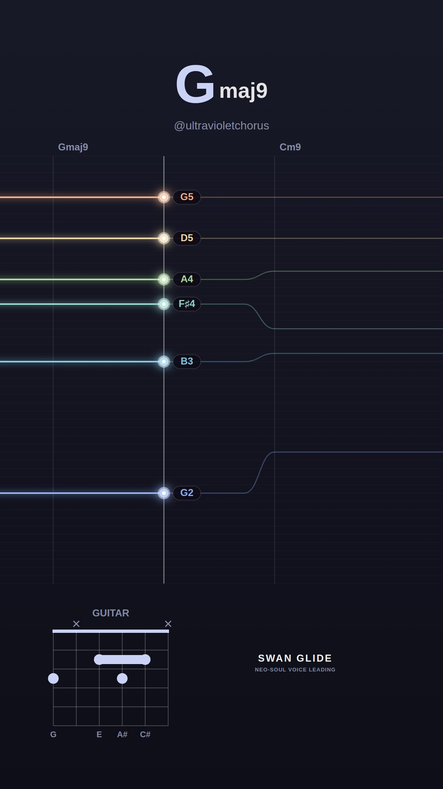
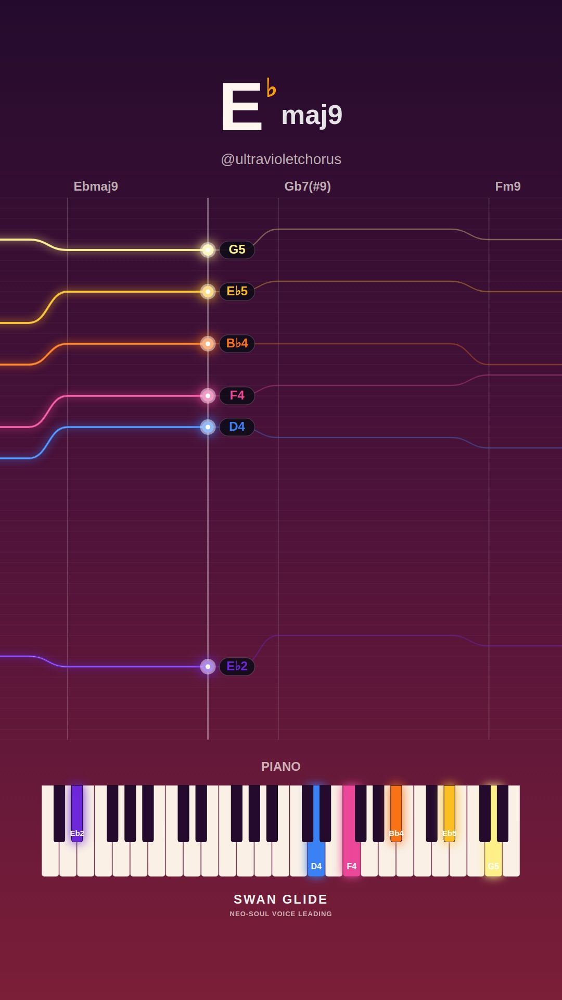
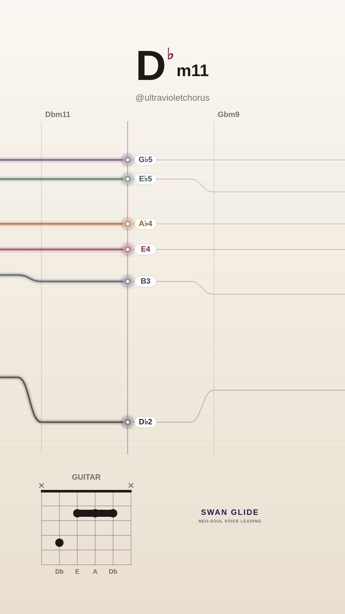
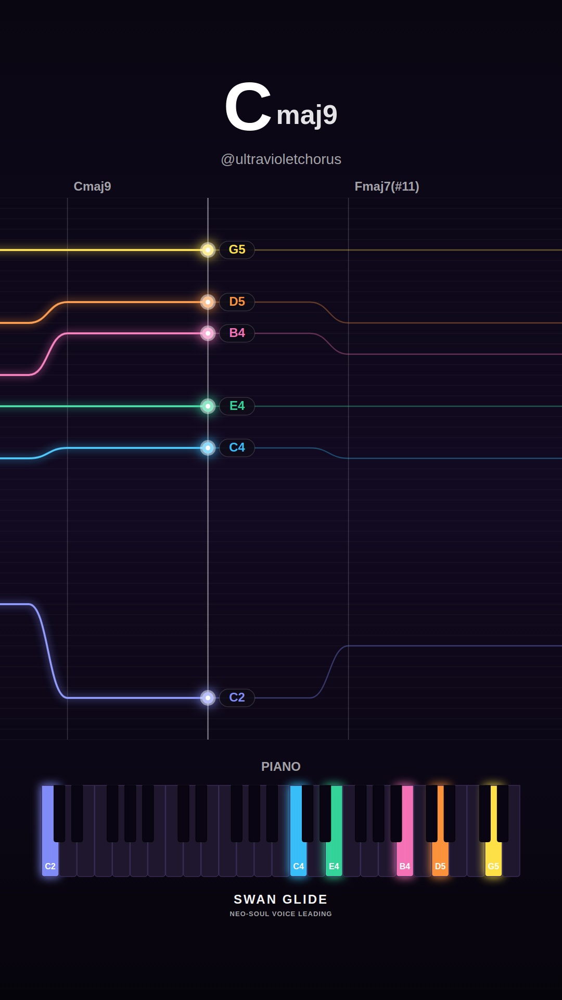
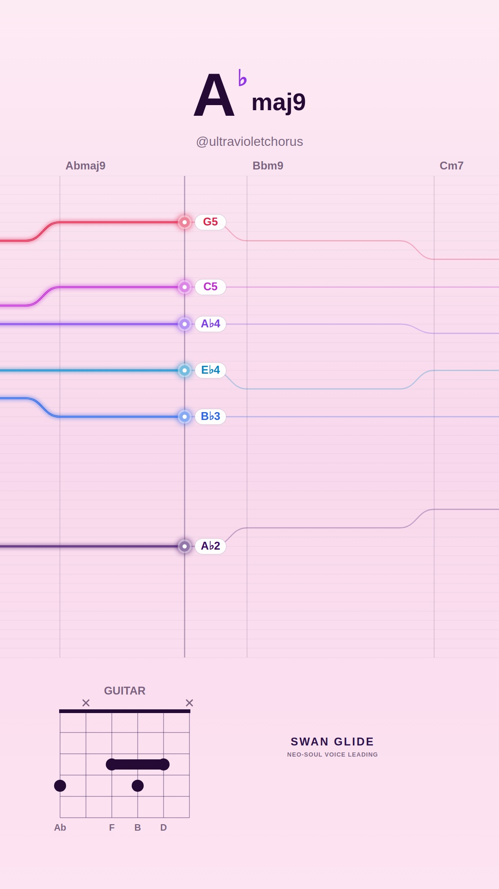
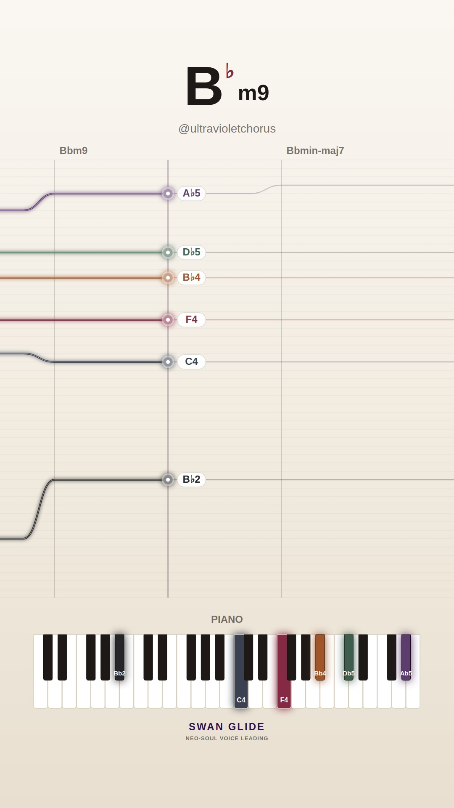
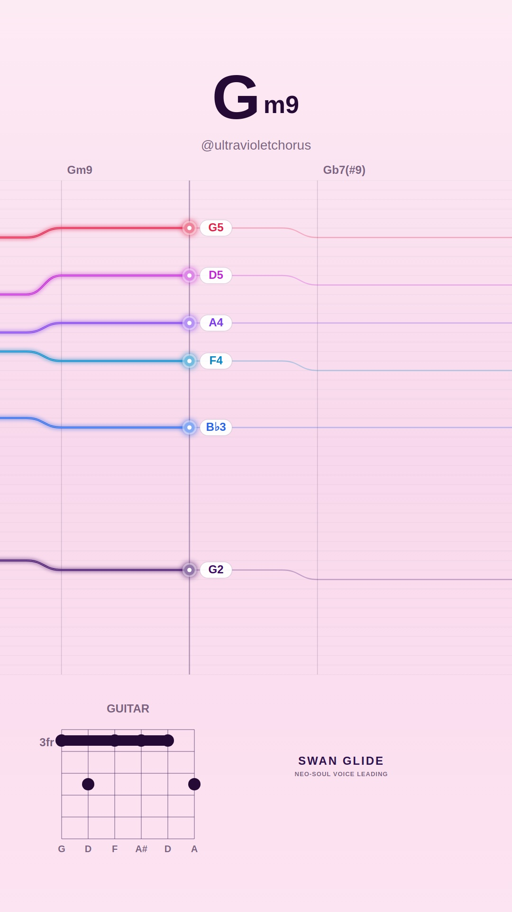
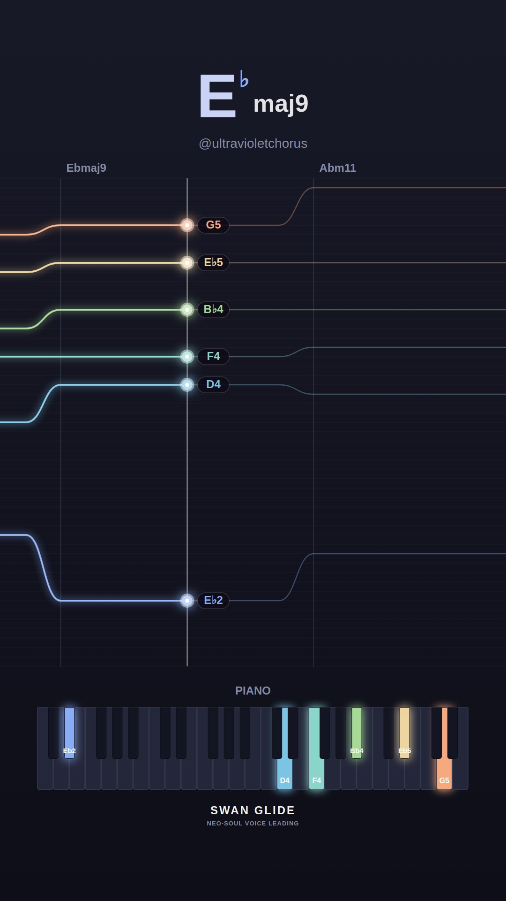
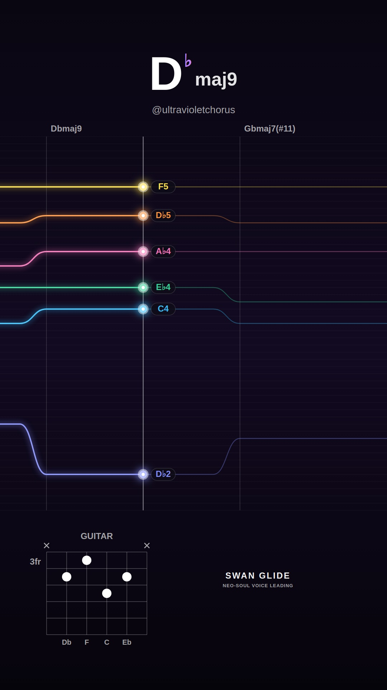
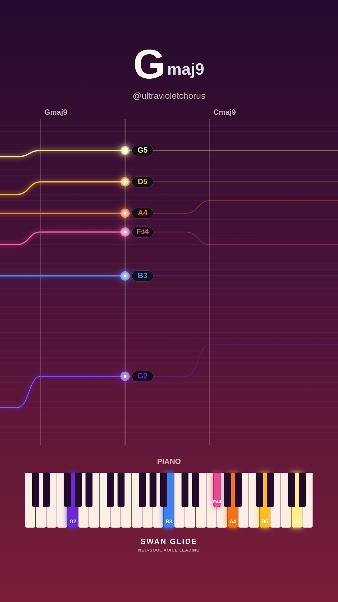

# 🕊️ Swan Glide Video Visualizer Gallery

Automated daily collection of procedural neo-soul jazz visualizers generated with the Swan Glide headless pipeline.

## 📅 Daily Archives
- [**2026-11-12**](./2026-11-12/README.md) (10 videos)
- [**2026-11-10**](./2026-11-10/README.md) (10 videos)
- [**2026-11-09**](./2026-11-09/README.md) (10 videos)
- [**2026-11-08**](./2026-11-08/README.md) (10 videos)
- [**2026-11-07**](./2026-11-07/README.md) (10 videos)
- [**2026-11-06**](./2026-11-06/README.md) (10 videos)
- [**2026-11-05**](./2026-11-05/README.md) (10 videos)
- [**2026-11-04**](./2026-11-04/README.md) (4 videos)

## ✨ Latest Daily Showcase (2026-11-12)

| # | Video Preview | Track & Harmony | Instrument & Theme | Chord Progression |
| :---: | :--- | :--- | :--- | :--- |
| **1** |  [▶️ **Watch Video**](./2026-11-12/song_1794503520_1_smooth-rnb/video.mp4) | **Silk & Honey (in G)** • Mood: `smooth-rnb` • Key: **G** • Tempo: 70 BPM | 🎸 Guitar 🎨 Preset: `lofi` | `Gmaj9` → `Cm9` → `F13` → `Gmaj9` |
| **2** |  [▶️ **Watch Video**](./2026-11-12/song_1794503561_2_spicy-altered/video.mp4) | **Tritone Whispers (in Eb)** • Mood: `spicy-altered` • Key: **Eb** • Tempo: 70 BPM | 🎹 Piano 🎨 Preset: `sunset` | `Ebmaj9` → `Gb7(#9)` → `Fm9` → `Bb7(#9)` → `Gm9` → `C7(b13)` → `Fm9` → `E7(b13)` |
| **3** |  [▶️ **Watch Video**](./2026-11-12/song_1794503627_3_melancholy-minor/video.mp4) | **Quiet Solitude (in Db)** • Mood: `melancholy-minor` • Key: **Db** • Tempo: 64 BPM | 🎸 Guitar 🎨 Preset: `cream` | `Dbm11` → `Gbm9` → `B13` → `Emaj9` → `Ebm7b5` → `Ab7(b13)` |
| **4** |  [▶️ **Watch Video**](./2026-11-12/song_1794503693_4_dreamy-major/video.mp4) | **Lydian Shimmer (in C)** • Mood: `dreamy-major` • Key: **C** • Tempo: 65 BPM | 🎹 Piano 🎨 Preset: `dark` | `Cmaj9` → `Fmaj7(#11)` → `Em7` → `Am9` |
| **5** |  [▶️ **Watch Video**](./2026-11-12/song_1794503737_5_dreamy-major/video.mp4) | **Celestial Drift (in Ab)** • Mood: `dreamy-major` • Key: **Ab** • Tempo: 65 BPM | 🎸 Guitar 🎨 Preset: `pastel` | `Abmaj9` → `Bbm9` → `Cm7` → `Dbmaj7(#11)` → `Fm9` → `Eb13` → `Dbmaj9` → `Ab6/9` |
| **6** |  [▶️ **Watch Video**](./2026-11-12/song_1794503803_6_melancholy-minor/video.mp4) | **Paper Lanterns (in Bb)** • Mood: `melancholy-minor` • Key: **Bb** • Tempo: 65 BPM | 🎹 Piano 🎨 Preset: `cream` | `Bbm9` → `Bbmin-maj7` → `Bbm7` → `Ebm9` |
| **7** |  [▶️ **Watch Video**](./2026-11-12/song_1794503847_7_spicy-altered/video.mp4) | **Altered Smoke (in F)** • Mood: `spicy-altered` • Key: **F** • Tempo: 68 BPM | 🎸 Guitar 🎨 Preset: `pastel` | `Gm9` → `Gb7(#9)` → `Fmaj9` → `D7(b13)` → `Ab7(#9)` |
| **8** |  [▶️ **Watch Video**](./2026-11-12/song_1794503887_8_smooth-rnb/video.mp4) | **Warm Rhodes Breeze (in Eb)** • Mood: `smooth-rnb` • Key: **Eb** • Tempo: 73 BPM | 🎹 Piano 🎨 Preset: `lofi` | `Ebmaj9` → `Abm11` → `Db13` → `Fm9` → `Bb7(b13)` |
| **9** |  [▶️ **Watch Video**](./2026-11-12/song_1794503933_9_dreamy-major/video.mp4) | **Celestial Drift (in Db)** • Mood: `dreamy-major` • Key: **Db** • Tempo: 64 BPM | 🎸 Guitar 🎨 Preset: `dark` | `Dbmaj9` → `Gbmaj7(#11)` → `Fm9` → `Bbm9` → `Ebm9` → `Ab13` |
| **10** |  [▶️ **Watch Video**](./2026-11-12/song_1794503999_10_smooth-rnb/video.mp4) | **Silk & Honey (in G)** • Mood: `smooth-rnb` • Key: **G** • Tempo: 67 BPM | 🎹 Piano 🎨 Preset: `sunset` | `Gmaj9` → `Cmaj9` → `Bm7` → `Em9` → `Am9` → `D13` |

*All videos rendered at 1080x1920 60FPS with 48kHz synthesized audio.*
